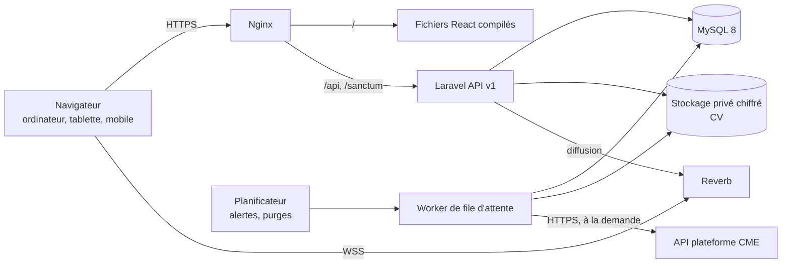

# Document d'architecture – JobDating YouCode (refonte)

| | |
|---|---|
| **Version** | 1.0 – 11/11/2026 |
| **Statut** | Proposition à valider par le responsable technique |
| **Référence fonctionnelle** | `CAHIER_DES_CHARGES_JOBDATING_V2.md` (ci-après « CDC ») |
| **Stack** | Laravel 12 (PHP 8.4) + React 19 (TypeScript) – MySQL 8 |
| **Contexte** | Application recréée à zéro. L'ancienne application sert uniquement de référence en lecture et de source pour la reprise des données. |

Ce document traduit le CDC en décisions techniques directement applicables. Il ne crée aucune fonctionnalité : en cas de doute, le CDC fait foi.

Chaque choix porte l'un de ces statuts :

- **Fixé** : décidé dans le CDC (section 9 ou annexe C) ; ne pas remettre en cause.
- **Proposé** : choix technique laissé ouvert par le CDC (« bibliothèque à choisir ») ; à valider avant l'initialisation.

---

## 1. Décisions d'architecture

### 1.1 Décisions fixées par le CDC

| Sujet | Décision | Source |
|---|---|---|
| Backend | PHP 8.4, Laravel 12 ; contrôleurs, services, modèles ; validation par Form Requests ; sérialisation par API Resources | CDC 9.3 |
| Frontend | React 19, TypeScript, Vite, Tailwind CSS, React Router ; organisation par modules fonctionnels | CDC 9.2 |
| Base de données | MySQL 8 en mode strict, migrations versionnées, clés étrangères et unicités conformes aux règles de gestion | CDC 9.4 |
| Authentification | Laravel Sanctum en **session par cookie** (`httpOnly`, `Secure`, `SameSite`) + CSRF ; **aucun jeton d'accès** ; application et API sous un même domaine parent | CDC 9.5, PC-36 |
| Session | 12 heures ; fermée à la déconnexion, au changement de mot de passe et à la désactivation du compte | RG-AUTH-02, RG-AUTH-12, RG-ACC-05 |
| Autorisation | Spatie Permission (rôles et permissions), policies par ressource, middleware de rôle par groupe de routes, ressources toujours recherchées dans le périmètre de l'utilisateur | CDC 9.5, RG-ACC-02 |
| Rôles | 5 rôles, **un seul rôle par compte** : Administrateur, CME, Direction, Entreprise, Apprenant | RG-ACC-06 |
| API | `/api/v1`, documentée OpenAPI, pagination plafonnée à **100**, tri limité à une liste blanche, format d'erreur homogène | CDC 9.3, RG-ENT-04 |
| Statistiques | **Un seul service de statistiques**, alimenté par un objet de filtres validé, utilisé par l'écran **et** l'export | RG-EXP-01 |
| Exports | CSV et Excel générés côté serveur **en flux**, téléchargés directement, **jamais stockés** ; neutralisation des formules | RG-EXP-04, RG-EXP-05 |
| Temps réel | Laravel Reverb, canaux privés par utilisateur ; son arrêt ne bloque ni l'enregistrement ni la consultation des notifications | CDC 9.7, RG-NOT-01 |
| Arrière-plan | File d'attente (imports de CV, notifications) et planificateur (alertes toutes les 2 h de 8 h à 18 h, purges) | CDC 9.1, annexe C « Export » |
| CV | PDF uniquement, contrôle du type réel et de la taille, stockage privé **chiffré au repos**, servi par lien temporaire après contrôle des droits, une seule version par apprenant | RG-CV-01 à 06, PC-18 |
| Hors connexion | Pas de mode hors connexion ; **sauvegarde automatique** de chaque choix de l'évaluation sur le serveur | PC-42, RG-PAS-11 |
| Conservation | Passages et évaluations sans limite ; journaux 1 an puis purge automatique | EXI-DATA-02 |
| Fuseau horaire | Heure du Maroc : la « fin du jour de l'événement » est minuit, heure du Maroc | RG-PAS-10 |

### 1.2 Choix proposés (laissés ouverts par le CDC)

| Besoin | Proposition | Raison |
|---|---|---|
| Cache et accès aux données côté React | **TanStack Query** | Cache, invalidation, nouvelles tentatives automatiques (utile pour la sauvegarde automatique de l'évaluation) |
| Formulaires | **React Hook Form + Zod** | Validation typée, formulaires d'évaluation et d'administration |
| Composants accessibles | **Radix UI** (dialogues, menus, listes) stylés avec Tailwind selon les maquettes | Accessibilité sans imposer de style |
| Graphiques des statistiques | **Recharts** | Simple, suffisant pour barres et courbes |
| Client temps réel | **laravel-echo + pusher-js** (protocole de Reverb) | Standard Laravel |
| Génération Excel / CSV | **OpenSpout** | Écriture en flux, faible mémoire, adaptée au « jamais stocké » |
| Documentation OpenAPI | **Scramble** (`dedoc/scramble`) | Générée depuis les Form Requests et Resources, sans annotations à maintenir |
| Tests backend | **Pest** + couverture | Lisible, datasets pratiques pour la matrice des droits |
| Analyse statique et style PHP | **Larastan** (niveau 6 minimum) + **Laravel Pint** | Exigé par CDC 9.8 et EXI-MAIN-03 |
| Tests frontend | **Vitest** + Testing Library ; **Playwright** pour le parcours entreprise de bout en bout | CDC 11.1 |
| Lint frontend | ESLint + Prettier + `tsc --noEmit` à chaque build | CDC 9.2 |
| File d'attente | Pilote **database** | Pas de serveur Redis à exploiter ; volumétrie compatible |
| Cache applicatif et limitation de débit | Pilote **database** (Redis possible plus tard sans changer le code) | Idem |
| Mots de passe courants | Liste locale de mots de passe courants, en plus des 10 caractères minimum | RG-AUTH-07, sans appel à un service externe |
| Déploiement | Frontend compilé servi par Nginx **sur la même adresse** que l'API (`/` pour l'application, `/api` pour l'API) | Option prévue par CDC 9.5 ; supprime toute configuration CORS |

---

## 2. Vue d'ensemble



Processus à faire tourner en production (supervisés) : PHP-FPM, `queue:work`, `reverb:start`, `schedule:work` (ou tâche cron chaque minute).

---

## 3. Structure du dépôt

Un seul dépôt (monorepo), nouveau, sans historique de l'ancienne application.

```
jobdating/
├── backend/                 Laravel 12
├── frontend/                React 19 + Vite
├── docs/
│   ├── CAHIER_DES_CHARGES_JOBDATING_V2.md
│   ├── ARCHITECTURE_JOBDATING.md        (ce document)
│   ├── BACKLOG.md
│   └── decisions/                       (une fiche par décision technique)
├── .github/workflows/ci.yml
├── CLAUDE.md                            (conventions pour les assistants IA)
└── README.md                            (installation locale)
```

### 3.1 Backend

```
backend/app/
├── Http/
│   ├── Controllers/Api/V1/{Admin,Cme,Company,Learner,Shared}/
│   ├── Requests/            (une Form Request par action)
│   ├── Resources/           (une Resource par entité exposée)
│   └── Middleware/
├── Models/
├── Policies/
├── Services/                (logique métier, testée unitairement)
│   ├── Passages/            (démarrer, terminer, annuler, régulariser)
│   ├── Evaluations/
│   ├── Statistics/          (StatisticsService + StatisticsFilters)
│   ├── Exports/             (écriture en flux CSV / XLSX)
│   ├── Imports/             (fichier YouCode School Admin, entreprises)
│   ├── Cv/                  (téléversement, client API CME)
│   └── Audit/
├── Jobs/                    (import CV, envoi de notifications)
├── Notifications/
├── Enums/                   (statuts, suites, niveaux, rôles)
└── Console/Commands/        (alertes, purges, reprise des données)
```

Règles :

- un contrôleur ne contient aucune logique métier : il valide (Form Request), autorise (Policy), appelle un service, renvoie une Resource ;
- les valeurs métier fixes (statuts, suites) sont des `enum` PHP ; les listes administrables (secteurs, opportunités, étiquettes, filières, classes, promotions, campus) sont des tables de référentiel (EXI-MAIN-02) ;
- toute écriture métier passe par un service qui écrit aussi dans le journal d'audit.

### 3.2 Frontend

```
frontend/src/
├── app/                     (routeur, fournisseurs, garde de rôle)
├── lib/                     (client API, gestion 401/403, Echo, formatage)
├── components/              (boutons, cartes, tableaux, barre de filtres)
└── modules/
    ├── auth/
    ├── company/             (tableau de bord, apprenants, entretien, mes passages)
    ├── learner/             (Ma journée, passages, CV)
    ├── cme/
    ├── admin/
    ├── direction/
    ├── statistics/          (partagé CME, admin, direction, entreprise)
    └── notifications/
```

Règles :

- menus, droits et listes de choix viennent de l'API (`GET /api/v1/me` renvoie le rôle et les permissions) ; rien n'est codé en dur (CDC 9.2) ;
- l'état des filtres est stocké dans l'adresse de la page (paramètres d'URL) ;
- un intercepteur unique gère 401 (retour à la connexion puis à la page demandée) et 403 (retour à l'accueil du rôle avec message, RG-ACC-03) ;
- l'espace entreprise est conçu d'abord pour mobile (375 px, EXI-COMP-02).

---

## 4. Données

Le schéma complet est en CDC 8.2. Ordre des migrations (respecte les clés étrangères) :

1. Référentiels : `campuses`, `filieres`, `promotions`, `classes`, `sectors`, `opportunity_types`, `evaluation_tags_ref`
2. Comptes : `users`, tables Spatie Permission, `companies`, `learners`
3. Événements : `events`, `event_program_items`, `event_companies`, `event_learners`
4. Activité : `passages`, `evaluations`, `evaluation_opportunities`, `evaluation_tags`
5. CV : `cv_documents`, `cv_import_logs`, `cv_access_logs`
6. Transverse : `notifications`, `audit_logs`, `export_logs`, `imports`
7. Techniques Laravel : `sessions`, `jobs`, `failed_jobs`, `cache`

Points techniques :

| Point | Mise en œuvre |
|---|---|
| Double soumission (RG-PAS-05) | Le frontend génère un identifiant unique (`client_request_id`, UUID) à chaque appui sur « Démarrer l'entretien » ; colonne unique sur `passages`. Une requête rejouée renvoie le passage déjà créé. Ce n'est pas une contrainte d'unicité métier : RG-PAS-01 reste respectée. |
| Passages | Aucune unicité sur (événement, entreprise, apprenant) ; index de CDC 8.4 ; suppression logique |
| Évaluation | `passage_id` unique ; tous les champs facultatifs (PC-40) ; chaque champ sauvegardé par `PATCH` dès qu'il change |
| Événement courant | Un seul `events.est_courant = true`, garanti par le service (et testé) |
| Apprenants distincts | Toujours calculés par `COUNT(DISTINCT learner_id)` sur le périmètre filtré, jamais stockés (CDC 8.6) |
| CNIE | Colonne unique ; jamais incluse dans une Resource destinée à un autre rôle que l'administrateur |
| Journal d'audit | Table en ajout seul ; aucune route de modification ni de suppression |
| Fuseau | `APP_TIMEZONE=Africa/Casablanca` ; dates stockées en heure du Maroc, cohérentes avec la règle « minuit, heure du Maroc » |

---

## 5. Sécurité et droits

### 5.1 Permissions

Une permission par ligne de la matrice CDC 3.2, nommée `domaine.action` (exemples : `passages.create`, `evaluations.update`, `stats.global.view`, `cv.upload`, `audit.view`). Les rôles reçoivent leurs permissions par un seeder **versionné**, identique dans tous les environnements.

### 5.2 Trois niveaux de contrôle sur chaque route

1. **Middleware** `auth:sanctum` + rôle du groupe de routes.
2. **Policy** : la ressource est-elle dans le périmètre de l'utilisateur ? Une ressource hors périmètre renvoie **404**, pas 403 (RG-ACC-02).
3. **Règles de date** pour l'entreprise : démarrer, compléter, modifier ou annuler un passage n'est permis que **le jour de l'événement** (RG-PAS-10, RG-PAS-12). La vérification est faite dans la Policy, à partir de `events.date` et de l'heure du Maroc.

Périmètre entreprise (PC-04) : pendant l'événement courant, tous les apprenants inscrits ; après l'événement, seulement les apprenants qu'elle a rencontrés. Ce périmètre est implémenté **une seule fois** (une portée Eloquent) et réutilisé par la liste, la fiche, le CV et l'export.

### 5.3 Autres mesures

| Exigence | Mise en œuvre |
|---|---|
| Limitation de débit (RG-AUTH-01) | Connexion : 5/min par identifiant + IP, et 100/min par IP. Limites aussi sur réinitialisation, activation, exports |
| Secrets (EXI-SEC-01) | Uniquement dans `.env` par environnement ; `.env.example` sans aucune valeur réelle |
| Production (EXI-SEC-05) | `APP_DEBUG=false` ; erreurs génériques côté utilisateur, détails dans les journaux |
| En-têtes (EXI-SEC-09) | HSTS, CSP, `X-Content-Type-Options` posés par Nginx |
| Données initiales de production (EXI-SEC-11) | Seeders de production : référentiels et permissions uniquement. Aucun compte de test. Le premier administrateur est créé par une commande Artisan interactive |
| Données de développement | Factories avec données **fictives** uniquement ; aucune donnée réelle d'apprenant (nom, CNIE, téléphone) dans le dépôt |
| CV | Disque privé ; contenu chiffré avec la clé de l'application ; lien de téléchargement signé et de courte durée ; chaque consultation journalisée (RG-CV-02) |

---

## 6. Conventions d'API

- Préfixe `/api/v1`, noms de ressources en anglais, au pluriel (`/passages`, `/events/{event}/learners`).
- Réponse de liste : `{ data: [...], meta: { current_page, per_page, total }, links: {...} }` ; `per_page` borné à 100.
- Tri : `?sort=champ` ou `?sort=-champ`, champ vérifié contre une liste blanche par endpoint.
- Filtres : `?filter[campus]=…&filter[filiere]=…` ; validés par la même classe que le service de statistiques.
- Erreurs : format homogène.

```json
{ "message": "Texte compréhensible par l'utilisateur", "code": "PASSAGE_EVENT_CLOSED", "errors": { "champ": ["…"] } }
```

- Codes : 401 non connecté, 403 action interdite, 404 introuvable ou hors périmètre, 409 conflit d'état (ex. passage annulé), 422 validation, 429 trop de tentatives.

---

## 7. Fonctionnements particuliers

### 7.1 Entretien et sauvegarde automatique

1. « Démarrer l'entretien » → `POST /passages` avec `client_request_id` → passage « À évaluer », heure de démarrage posée par le serveur.
2. Chaque choix de la grille → `PATCH /passages/{id}/evaluation` (regroupement de 500 ms côté frontend). En cas d'échec réseau : message « Non sauvegardé, nouvelle tentative… » et nouvelle tentative automatique (TanStack Query).
3. « Terminer l'entretien » → `POST /passages/{id}/finish` → statut « Évalué », heure de fin posée par le serveur.
4. Aucune heure n'est envoyée par le client, sauf dans la régularisation administrateur (ADM-10).

### 7.2 Statistiques et exports

`StatisticsFilters` (objet validé) → `StatisticsService` → soit une Resource JSON (écran), soit un `StreamedResponse` OpenSpout (export). Un test automatique compare, pour les mêmes filtres, les données de l'écran et celles de l'export (CDC 11.5, RG-EXP-01). Le format Excel suivra le modèle de l'équipe CME (PC-43) ; en attendant, la structure par défaut du CDC 5.7 (onglets « Filtres appliqués », « Indicateurs », « Détail »).

### 7.3 Notifications et alertes

- Notifications Laravel, canaux `database` + `broadcast` ; envoi en file d'attente.
- Commande planifiée toutes les 2 heures de 8 h à 18 h le jour de l'événement : apprenants sous le seuil de passages (paramétrable) → notification à l'équipe CME (NOTIF-02).
- Purge planifiée quotidienne des journaux de plus d'un an.

### 7.4 Plateforme CME

Client HTTP isolé derrière une interface (`CmeCvClient`), avec délais d'attente, nouvelles tentatives et respect des limites d'appels. Tant que l'API n'est pas livrée (PC-26), une implémentation factice permet de développer et tester le bouton d'import. Le téléversement manuel (CV-01) ne dépend pas de l'API.

### 7.5 Imports

Fichier YouCode School Admin (un par campus) : aperçu, contrôles RG-IMP-01 à 07, rapport, fichier des mots de passe téléchargeable une seule fois. Lecture avec OpenSpout. Traitement synchrone si le fichier est petit, en file d'attente sinon.

---

## 8. Reprise des données de l'ancienne application

Le CDC (8.8, priorité haute) demande de reprendre l'historique. Mise en œuvre : une commande `php artisan jobdating:reprise` qui lit l'ancienne base par une **connexion séparée en lecture seule**, écrit dans la nouvelle base, et produit un rapport de contrôle (CDC 8.8, point 6). Elle est rejouable sur une base vide.

Correspondances observées dans l'ancien schéma :

| Ancien | Nouveau | Règle |
|---|---|---|
| `companies` (+ `users`) | `companies` + `users` | Les entreprises gardent un compte (annexe C « Participation ») ; nom d'utilisateur généré selon ADM-02 |
| `learners.filiere` (texte libre) | `classes` / `filieres` | Table de correspondance validée ; valeurs hors référentiel listées pour décision |
| `interviews` | `passages` | Date et heure d'origine ; statut « Évalué » |
| `interviews.interest_level` | `evaluations.suite` | `highly_interested` → Retenu, `interested` → À l'étude, `not_interested` → Non retenu (PC-23) |
| `interviews.company_notes` | `evaluations.commentaire` | Repris tel quel |
| `interviews.technical_rating`, `soft_skills_rating` | à créer : champ de notes historiques en lecture seule | Le CDC demande de les conserver en consultation, sans conversion ; le modèle 8.2 n'a pas encore de champ pour elles |
| `interviews.learner_feedback` | archive | Non repris ni affiché (PC-11) |
| `attachments` (documents de type CV) | archive | Non présentés (CDC 8.8, point 5) |

Points à valider avant d'écrire la commande (voir section 12).

---

## 9. Environnements et déploiement

| Environnement | Usage | Données |
|---|---|---|
| Local | Développement | Factories fictives |
| Préproduction | Recette par l'équipe CME, test de charge, répétition générale | Jeu fictif représentatif (224 apprenants, 7 CME, entreprises) |
| Production | Jour J | Données réelles, aucun compte de test |

- Un même domaine pour l'application et l'API (section 1.2).
- Sauvegarde quotidienne de la base et du stockage des CV ; restauration testée au moins une fois avant le jour J (EXI-FIA-02).
- Aucun déploiement le jour d'un événement (EXI-DISP-01).
- **Mise en ligne dès la semaine 1** d'une version minimale (connexion + une page) sur l'hébergement final, pour valider tôt le domaine, HTTPS, les cookies de session, Reverb et les processus supervisés.

---

## 10. Qualité et intégration continue

Pipeline exécuté à chaque push et chaque demande de fusion :

| Étape | Backend | Frontend |
|---|---|---|
| Style | `pint --test` | `eslint`, `prettier --check` |
| Types / analyse | `larastan` | `tsc --noEmit` |
| Tests | `pest --coverage` (seuil 80 % sur `app/Services`, EXI-MAIN-01) | `vitest run` |
| Dépendances | `composer audit` | `npm audit --audit-level=high` |
| Build | — | `vite build` |

Test de bout en bout Playwright du parcours entreprise du jour J : avant chaque mise en production.

Test de la matrice des droits : un dataset Pest construit **chaque cellule** de la matrice CDC 3.2 (action × rôle → attendu), exécuté contre l'API réelle.

---

## 11. Règles de travail (contenu de `CLAUDE.md`)

- Le CDC V2 fait foi ; ne jamais inventer une fonctionnalité ou une règle. En cas de doute : poser la question.
- **Une user story par branche** (`us-05-demarrer-passage`), une demande de fusion par story.
- **Définition de « terminé »** pour une story :
  1. critères d'acceptation du CDC couverts par des tests ;
  2. droits testés pour les 5 rôles ;
  3. pipeline vert ;
  4. écran conforme à la maquette, vérifié à 375 px si l'écran est utilisé sur mobile ;
  5. écritures métier présentes dans le journal d'audit ;
  6. revue faite par une autre personne ou un autre outil que l'auteur.
- Messages de commit en français, à l'impératif, avec l'identifiant de la story (`US-05 : créer le passage au démarrage`).
- Aucune donnée personnelle réelle dans le code, les tests, les seeders ou les captures.

---

## 12. Points ouverts

| ID | Point | Impact | À qui |
|---|---|---|---|
| PC-26 | API de la plateforme CME : documentation, environnement de test, identifiant commun, authentification | Import CV-02 (le téléversement manuel n'est pas bloqué) | CME, TECH |
| PC-43 | Modèle de l'export Excel de l'équipe CME | Mise en forme de l'export (le calcul n'est pas bloqué) | PO, CME |
| ARCH-01 | Hébergement de production et nom de domaine | Mise en ligne de la semaine 1 | TECH |
| ARCH-02 | Validation des choix « proposés » de la section 1.2 | Initialisation du projet | TECH |
| REP-01 | Rapprochement des apprenants de l'ancienne application : l'ancien schéma n'a pas de CNIE. Proposition : rapprochement par e-mail professionnel, apprenants non rapprochés listés pour décision | Reprise des passages historiques | PO, TECH |
| REP-02 | Anciennes rencontres aux statuts `scheduled`, `in_progress` ou `cancelled` : les reprendre (et avec quel statut) ou les ignorer | Reprise | PO |
| REP-03 | Champ de notes historiques sur 5 à ajouter au modèle `evaluations` (CDC 8.8 point 2) | Modèle de données | TECH |
| REP-04 | Calendrier de la reprise : les **entreprises** doivent être reprises avant l'événement (elles gardent leur compte) ; les **passages historiques** peuvent l'être après | Planning | PO, TECH |
