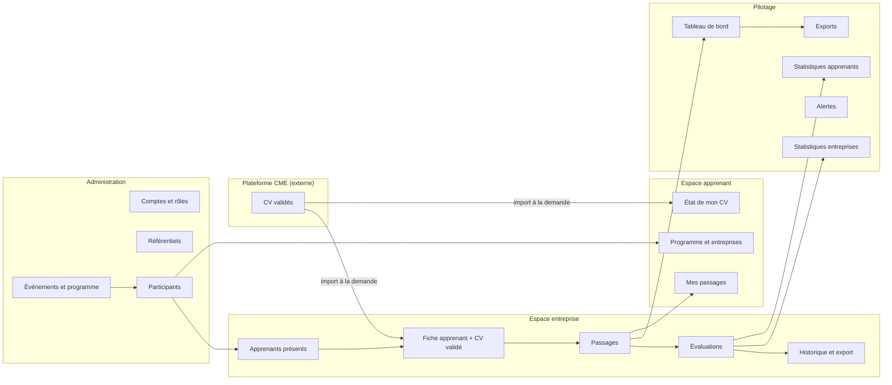
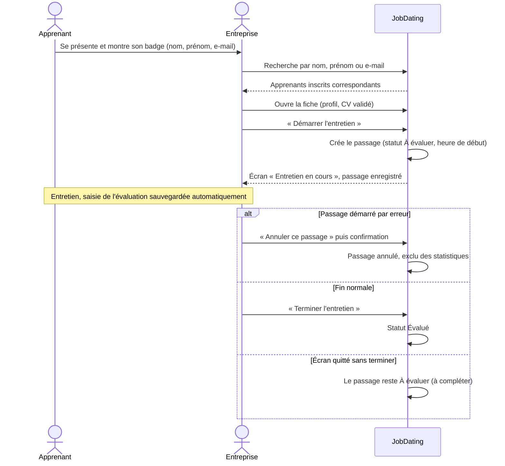
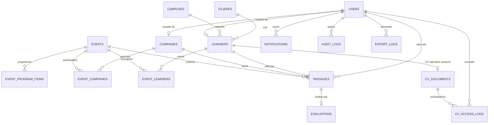
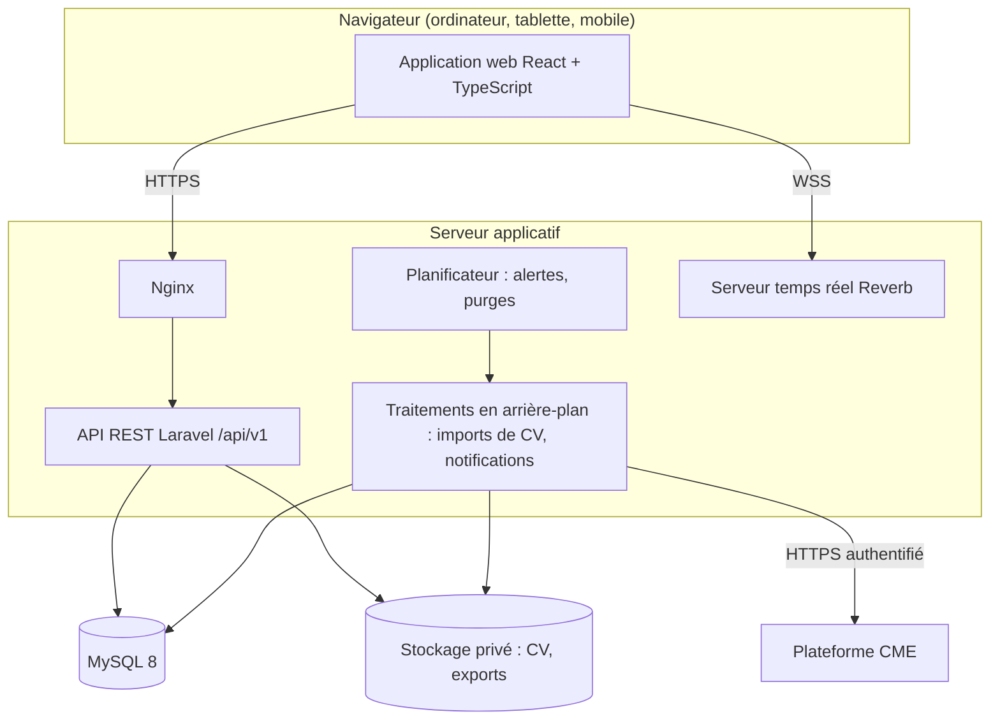

# Cahier des charges fonctionnel – Application JobDating YouCode (V2)

| Élément | Valeur |
|---|---|
| Version | 2.0 |
| Date | 09/11/2026 |
| Objet | Description des besoins et des fonctionnalités attendues de l'application JobDating |
| Destinataires | Product Owner, UX/UI Designer, développeurs Backend et Frontend, QA |
| Statut | À valider. Les éléments marqués **[À clarifier – PC-xx]** renvoient à la section 13 et doivent être tranchés avant leur conception détaillée |

## Conventions

- **Doit** : exigence obligatoire. **Devrait** : recommandation forte. **Peut** : option.
- **RG-xxx** : règle de gestion. **EXI-xxx** : exigence non fonctionnelle. **PC-xx** : point à clarifier (section 13).

## Glossaire

| Terme | Définition |
|---|---|
| Événement (JobDating) | Une édition de rencontres entre apprenants YouCode et entreprises partenaires, organisée sur une journée. |
| Événement courant | L'événement mis en avant par défaut dans l'application. Il en existe au plus un à la fois. |
| Programme | Agenda informatif de l'événement (accueil, conférences, pauses…), consultable par les participants. |
| Participation | Inscription d'une entreprise ou d'un apprenant à un événement. |
| Passage | Une rencontre entre **un** apprenant et **une** entreprise, à un moment donné, dans un événement. Chaque rencontre est une occurrence distincte, même si le même apprenant rencontre plusieurs fois la même entreprise. |
| Évaluation | Appréciation saisie par l'entreprise sur un passage : suite envisagée, opportunité, niveaux par critère, points forts et à améliorer, commentaire. Tous les champs sont facultatifs. |
| Apprenant distinct | Un apprenant compté une seule fois dans un indicateur, quel que soit son nombre de passages dans le périmètre filtré. |
| Plateforme CME | Plateforme externe à JobDating, gérée par l'équipe CME, sur laquelle l'apprenant dépose son CV. Le CV y est corrigé et validé. JobDating peut l'importer à la demande grâce à l'API de la plateforme CME. |
| CV validé | CV présenté aux entreprises dans JobDating : téléversé par l'administrateur ou l'équipe CME, ou importé depuis la plateforme CME. Le dernier CV ajouté, quelle que soit sa source, remplace le précédent. |
| Équipe CME (Chargé Média Emploi) | Équipe YouCode qui prépare et pilote les JobDating et qui gère la plateforme CME. Dans JobDating, ses membres ont le rôle « CME ». Pour éviter toute confusion, l'interface et ce document distinguent toujours « équipe CME » (les personnes, le rôle) et « plateforme CME » (l'outil de gestion des CV). |
| Référentiel | Liste de valeurs administrée en base (filières, classes, campus, promotions…) et utilisée dans toute l'application. |

---

# 1. Présentation générale du projet

## 1.1 Contexte

YouCode organise régulièrement des JobDating. Ce sont des journées où ses apprenants rencontrent des entreprises partenaires lors d'entretiens courts. Pour préparer, conduire et analyser ces journées, YouCode a besoin d'une application qui réunit :

- la gestion des participants ;
- la consultation des profils et des CV ;
- l'enregistrement et l'évaluation de chaque rencontre ;
- le pilotage de l'activité par des statistiques fiables.

## 1.2 Problématique

- Le jour J, les entreprises doivent pouvoir, en quelques secondes, retrouver un apprenant, consulter un CV fiable et enregistrer leur appréciation, souvent depuis un téléphone ou une tablette.
- Un même apprenant peut rencontrer plusieurs fois la même entreprise. Chaque rencontre doit être conservée pour mesurer l'activité réelle.
- L'équipe CME doit disposer d'indicateurs exacts, qui distinguent le volume de rencontres et le nombre de personnes concernées. Elle doit pouvoir les croiser par événement, entreprise, apprenant et période, puis les exporter tels qu'affichés.
- Les CV présentés aux entreprises doivent avoir été corrigés et validés. La correction est assurée par l'équipe CME, sur sa plateforme ; le CV validé est ensuite ajouté dans JobDating.
- L'application traite des données personnelles et des évaluations nominatives. Elle doit garantir que chaque utilisateur n'accède qu'aux informations qui le concernent.

## 1.3 Objectifs

| N° | Objectif | Indicateur de réussite |
|---|---|---|
| O1 | Offrir aux entreprises un espace simple et rapide, utilisable pendant la journée | Depuis la fiche de l'apprenant, démarrer un entretien demande au plus 3 appuis (rechercher, ouvrir la fiche, « Démarrer l'entretien ») ; la grille se remplit sans clavier, sauf le commentaire ; tous les écrans de l'entreprise sont utilisables dans le navigateur d'un smartphone |
| O2 | Enregistrer chaque passage comme une occurrence fiable et datée | Aucun passage refusé au motif qu'une rencontre identique existe déjà ; 100 % des passages conservés |
| O3 | Fournir des statistiques justes, filtrables et exportables | Pour un même jeu de filtres, les chiffres affichés et exportés sont identiques (vérifié par tests automatisés) |
| O4 | Présenter uniquement des CV validés | Seuls l'administrateur et l'équipe CME ajoutent des CV ; chaque ajout est tracé |
| O5 | Protéger les données et les accès | Chaque droit est vérifié côté serveur et couvert par un test automatisé |

## 1.4 Périmètre

**Inclus :**
- authentification et gestion des comptes ;
- administration des événements, participants, programme et référentiels ;
- espace entreprise : consultation des apprenants et des CV, passages, évaluations, historique, export de ses données ;
- espace apprenant : programme, entreprises présentes, passages, état du CV ;
- statistiques, alertes de pilotage et exports ;
- ajout des CV par téléversement ou par import depuis la plateforme CME ;
- notifications internes ;
- journalisation, supervision et traçabilité ;
- reprise des données des éditions précédentes.

**Exclus :**
- développement ou modification de la plateforme CME ;
- gestion des offres d'emploi, des candidatures et du recrutement après le JobDating ;
- application mobile native : l'application web doit être pleinement utilisable sur mobile ;
- filières recherchées par les entreprises (non retenu, PC-14) ;
- export PDF (non retenu dans cette version, PC-32) ;
- notifications push navigateur (non retenues dans cette version, PC-17) : les notifications restent internes à l'application ;
- avis des apprenants sur les entreprises (non retenu dans cette version, PC-11).

## 1.5 Parties prenantes

| Partie prenante | Rôle | Attentes principales |
|---|---|---|
| Équipe CME (Chargé Média Emploi) | Prépare et pilote les événements ; gère la plateforme CME, où les CV sont corrigés et validés | Statistiques fiables, alertes, exports ; CV validés disponibles dans JobDating |
| Administrateurs YouCode | Paramètrent la plateforme et gèrent les comptes | Contrôle des accès, référentiels cohérents |
| Entreprises partenaires | Rencontrent et évaluent les apprenants | Interface rapide, CV fiables, historique |
| Apprenants | Participent aux rencontres | Programme, entreprises présentes, suivi de leurs passages |
| Responsables techniques de la plateforme CME | Fournissent l'API des CV | Contrat d'interface clair et sécurisé |
| Direction YouCode | Suit le JobDating en consultation | Vue complète des résultats, sans risque de modification |
| Délégué à la protection des données | Conformité | Base légale, durées de conservation, droits des personnes |
| Équipe de développement et QA | Réalisation et validation | Spécifications précises et testables |

---

# 2. Vision de la solution

## 2.1 Principes directeurs

1. **Le passage est l'unité de mesure de l'activité.** Tous les indicateurs d'activité se calculent à partir des passages. Les apprenants distincts se calculent par dédoublonnage sur le périmètre filtré.
2. **Une seule source de vérité par donnée.**
   - Les CV sont ajoutés uniquement par l'administrateur et l'équipe CME (téléversement ou import depuis la plateforme CME).
   - Les filières, classes, campus, promotions et autres listes viennent de référentiels administrés.
   - Les droits sont décidés par le serveur ; l'interface ne fait que les refléter.
3. **Même requête pour l'écran et l'export.** Les exports utilisent exactement les mêmes filtres et le même calcul que l'affichage.
4. **Simplicité pour les entreprises.** Peu d'écrans, actions principales en un ou deux gestes, priorité au mobile.
5. **Moindre privilège.** Chaque utilisateur n'accède qu'aux données nécessaires à son rôle et à son périmètre.
6. **Traçabilité.** Les actions sensibles sont journalisées : passages, évaluations, comptes, droits, exports, ajouts et consultations de CV.

## 2.2 Modules de la solution

## 2.3 Synthèse des fonctionnalités

| Module | Fonctionnalités | Identifiants |
|---|---|---|
| Authentification | Connexion, activation de compte, première connexion des apprenants, mot de passe oublié, changement de mot de passe | AUTH-01 à AUTH-03 |
| Administration | Utilisateurs, entreprises, apprenants, imports, événements, participants, programme, référentiels | ADM-01 à ADM-05, ADM-07 à ADM-10 |
| Espace entreprise | Tableau de bord, apprenants, fiche et CV, passage, évaluation, modification, historique, profil, export | ENT-01 à ENT-09 |
| Espace apprenant | Accueil « Ma journée », programme et entreprises, mes passages, état du CV | APP-00 à APP-03 |
| Statistiques et reporting | Tableau de bord, statistiques par entreprise et par apprenant, filtres, export, alertes | STAT-01 à STAT-06 |
| CV | Téléversement, import depuis la plateforme CME, consultation sécurisée, historique des ajouts | CV-01 à CV-04 |
| Notifications | Messages internes, alertes d'activité | NOTIF-01, NOTIF-02 |
| Traçabilité | Journal d'audit, journal des exports | TRA-01, TRA-02 |

---

# 3. Acteurs, rôles et droits

## 3.1 Profils

### Administrateur
- **Responsabilités** : paramétrage de la plateforme, gestion des comptes et des rôles, référentiels, événements et participants, supervision de l'intégration CME et des journaux.
- **Accès** : toutes les fonctions d'administration, de pilotage et d'export ; journal d'audit.
- **Restrictions** :
  - ne peut pas supprimer son propre compte ;
  - ne peut pas retirer le dernier compte administrateur ;
  - seul l'administrateur peut créer ou corriger un passage ou une évaluation au nom d'une entreprise (ADM-10).

### CME – Chargé Média Emploi
- **Responsabilités** : préparation et pilotage du JobDating. En dehors de JobDating, l'équipe CME gère la plateforme CME, où les CV des apprenants sont corrigés et validés (section 7). Dans JobDating, elle ajoute les CV validés des apprenants.
- **Accès** :
  - consultation des entreprises, apprenants, passages et évaluations ;
  - tableau de bord, statistiques, alertes et exports ;
  - envoi de notifications ;
  - téléversement ou remplacement du CV d'un apprenant, et import depuis la plateforme CME (CV-01, CV-02) ;
  - consultation de l'historique des ajouts de CV (CV-04) ;
  - gestion du programme de l'événement (ADM-08) ;
  - saisie de l'emplacement (étage, table) de chaque entreprise participante (ADM-07) ;
  - gestion des référentiels (ADM-09).
- **Restrictions** :
  - pas de création ni de modification d'événement : réservées à l'administrateur, pour éviter les doublons (un JobDating par an) ;
  - pas d'ajout ni de retrait d'entreprise ou d'apprenant dans l'événement : seulement la saisie des emplacements ;
  - pas de gestion des comptes (création des entreprises, import des apprenants, désactivation, réinitialisation des mots de passe), ni des paramètres de sécurité ;
  - aucune action au nom d'une entreprise (ADM-10) ;
  - pas de saisie d'évaluation.

### Entreprise
- **Responsabilités** : rencontrer les apprenants, enregistrer les passages et les évaluer.
- **Accès** : espace entreprise (section 4.3), son profil, ses propres statistiques et l'export de ses propres données.
- **Restrictions** :
  - pendant l'événement en cours, peut rechercher et consulter la fiche de tous les apprenants inscrits à cet événement, rencontrés ou non ;
  - après l'événement, ne consulte plus que les apprenants qu'elle a rencontrés (ses passages) ;
  - consulte uniquement des CV validés ;
  - voit uniquement ses propres passages et évaluations ;
  - n'a pas accès aux statistiques globales ni aux alertes.
- **Comptes** : un seul compte par entreprise, partagé par ses recruteurs. Tous les passages et évaluations sont enregistrés au nom de l'entreprise. Plusieurs recruteurs peuvent être connectés en même temps avec ce compte (par exemple deux tables) : chacun démarre ses entretiens et tout apparaît dans le même « Mes passages ».

### Apprenant
- **Responsabilités** : changer son mot de passe à la première connexion, participer aux rencontres et tenir son CV à jour sur la plateforme CME.
- **Accès** : programme et entreprises de ses événements, liste de ses passages, état de son CV dans JobDating, notifications.
- **Restrictions** :
  - accède uniquement à ses propres données ;
  - ne dépose ni ne modifie de CV dans JobDating ;
  - il voit les entreprises qui l'ont rencontré et l'heure de chaque passage, mais jamais les évaluations ni les commentaires des entreprises, qui restent réservés à l'équipe CME et à l'administrateur ; il n'est pas prévenu lorsqu'il est évalué.

### Direction (lecture seule)
- **Responsabilités** : suivre le JobDating sans intervenir.
- **Accès en consultation** : tableau de bord global et alertes, statistiques par entreprise et par apprenant, programme, entreprises, apprenants (fiches et CV validés), passages, évaluations et commentaires.
- **Export** : export Excel autorisé, avec les mêmes filtres que l'administrateur.
- **Restrictions** :
  - aucune création, modification, annulation ni suppression, quel que soit l'écran : aucun bouton d'action n'est affiché ;
  - pas d'accès à la gestion des comptes, des événements, des participants et des référentiels, ni au journal d'audit ; pas d'ajout de CV ;
  - les consultations de CV et les exports sont tracés dans le journal d'audit, comme pour les autres rôles.
- **Comptes** : créés par l'administrateur.

## 3.2 Matrice des droits

Légende : ✅ autorisé · 🔸 limité à son propre périmètre · ❌ interdit.

| Action | Admin | CME | Entreprise | Apprenant | Direction |
|---|---|---|---|---|---|
| Gérer les comptes et les rôles | ✅ | ❌ | ❌ | ❌ | ❌ |
| Modifier un apprenant, réinitialiser son mot de passe | ✅ | ❌ | ❌ | ❌ | ❌ |
| Consulter la CNIE d'un apprenant | ✅ | ❌ | ❌ | ❌ | ❌ |
| Gérer les référentiels | ✅ | ✅ | ❌ | ❌ | ❌ |
| Créer / modifier un événement | ✅ | ❌ | ❌ | ❌ | ❌ |
| Gérer le programme de l'événement | ✅ | ✅ | ❌ | ❌ | ❌ |
| Ajouter ou retirer des participants | ✅ | ❌ | ❌ | ❌ | ❌ |
| Saisir l'emplacement des entreprises | ✅ | ✅ | ❌ | ❌ | ❌ |
| Consulter le programme | ✅ | ✅ | 🔸 ses événements | 🔸 ses événements | ✅ |
| Consulter la liste des apprenants | ✅ | ✅ | 🔸 participants de ses événements | ❌ | ✅ |
| Consulter et télécharger un CV validé | ✅ | ✅ | 🔸 participants de ses événements | 🔸 le sien | ✅ |
| Consulter les entreprises | ✅ | ✅ | 🔸 sa fiche | 🔸 entreprises de ses événements | ✅ |
| Enregistrer un passage | ✅ au nom d'une entreprise (ADM-10) | ❌ | 🔸 pour elle-même, le jour de l'événement | ❌ | ❌ |
| Saisir / modifier une évaluation | ✅ au nom d'une entreprise (ADM-10) | ❌ | 🔸 ses passages, le jour de l'événement | ❌ | ❌ |
| Annuler un passage | ✅ | ❌ | 🔸 ses passages, le jour de l'événement | ❌ | ❌ |
| Changer l'apprenant d'un passage | ✅ (ADM-10) | ❌ | ❌ | ❌ | ❌ |
| Consulter les évaluations d'un apprenant | ✅ | ✅ | 🔸 les siennes | ❌ | ✅ |
| Tableau de bord global et alertes | ✅ | ✅ | ❌ | ❌ | ✅ |
| Statistiques par entreprise | ✅ | ✅ | 🔸 elle-même | ❌ | ✅ |
| Statistiques par apprenant | ✅ | ✅ | ❌ | ❌ | ✅ |
| Exporter | ✅ | ✅ | 🔸 ses données | ❌ | ✅ |
| Envoyer une notification | ✅ | ✅ | 🔸 à l'équipe CME uniquement | ❌ | ❌ |
| Téléverser ou importer le CV d'un apprenant | ✅ | ✅ | ❌ | ❌ | ❌ |
| Consulter l'historique des ajouts de CV | ✅ | ✅ | ❌ | ❌ | ❌ |
| Consulter le journal d'audit | ✅ | ❌ | ❌ | ❌ | ❌ |

## 3.3 Règles d'accès transverses

- **RG-ACC-01** : chaque droit est vérifié par le serveur pour chaque requête. L'interface masque les actions non autorisées mais ne constitue jamais la seule protection.
- **RG-ACC-02** : toute ressource qui appartient à un utilisateur (passage, évaluation, profil, document) est recherchée dans le périmètre de cet utilisateur. Une ressource hors périmètre est traitée comme inexistante.
- **RG-ACC-03** : un utilisateur qui demande une page non autorisée est redirigé vers la page d'accueil de son rôle, avec un message explicite. Aucune page ne reste vide ou bloquée.
- **RG-ACC-04** : les filtres et paramètres envoyés par l'utilisateur ne peuvent jamais élargir son périmètre d'accès.
- **RG-ACC-05** : un compte désactivé ou supprimé perd immédiatement toutes ses sessions actives.
- **RG-ACC-06** : chaque compte a un seul rôle (Administrateur, CME, Direction, Entreprise ou Apprenant). Une personne qui a besoin de plusieurs rôles reçoit le plus large : l'administrateur dispose déjà de tous les droits utiles.

---

# 4. Spécifications fonctionnelles détaillées

Chaque fonctionnalité est décrite selon la même structure :
- besoin ;
- acteurs ;
- préconditions ;
- scénario nominal ;
- scénarios alternatifs et exceptions ;
- règles de gestion ;
- données ;
- critères d'acceptation.

## 4.1 Authentification et comptes

### AUTH-01 – Se connecter

- **Besoin** : chaque utilisateur accède à son espace de façon sécurisée.
- **Acteurs** : tous.
- **Préconditions** : compte actif et activé.
- **Scénario nominal** :
  1. L'utilisateur saisit son e-mail **ou son nom d'utilisateur**, et son mot de passe. Les entreprises se connectent avec leur nom d'utilisateur (ADM-02) ; les autres rôles avec leur e-mail.
  2. Le système vérifie les identifiants et ouvre une session à durée limitée.
  3. L'utilisateur est dirigé vers la page d'accueil de son rôle :
     - Entreprise → tableau de bord entreprise ;
     - CME et Administrateur → tableau de bord de pilotage ;
     - Apprenant → accueil « Ma journée » (APP-00).
- **Exceptions** :
  - identifiants incorrects → message générique qui ne précise pas lequel est faux ;
  - nombre de tentatives dépassé → blocage temporaire avec message indiquant le délai d'attente ;
  - compte non activé → proposition de renvoyer le lien d'activation ;
  - compte désactivé → message « Votre compte est désactivé. Contactez l'administration. » ;
  - première connexion d'un apprenant avec son mot de passe généré → changement de mot de passe obligatoire avant d'accéder à son espace (RG-AUTH-13) ;
  - session expirée → retour à l'écran de connexion avec un message, puis retour à la page demandée après reconnexion.
- **Règles de gestion** :
  - RG-AUTH-01 : pour protéger les comptes contre la recherche de mot de passe par essais successifs (les noms d'utilisateur des entreprises étant faciles à deviner), les tentatives sont limitées à 5 par minute pour un même identifiant (e-mail ou nom d'utilisateur) depuis une même adresse IP. Une limite large par adresse IP seule (100 par minute) protège contre les attaques massives sans bloquer les participants qui partagent le Wi-Fi de l'événement ;
  - RG-AUTH-02 : la session expire après une durée définie de 12 heures, couvrant une journée de JobDating ;
  - RG-AUTH-03 : un utilisateur déjà connecté qui ouvre l'écran de connexion est dirigé vers son accueil ;
  - RG-AUTH-04 : la déconnexion met fin à la session immédiatement ;
  - RG-AUTH-05 : aucun compte de démonstration ou de test n'existe en production.
- **Données** : e-mail, mot de passe (stocké haché), session, date de dernière connexion.
- **Critères d'acceptation** :
  - au-delà du nombre de tentatives autorisé, le système refuse la connexion (HTTP 429) ;
  - une session expirée renvoie l'utilisateur à l'écran de connexion avec un message ;
  - un utilisateur connecté qui ouvre `/login` est redirigé vers son accueil.

### AUTH-02 – Activer son compte et définir son mot de passe

- **Besoin** : chaque utilisateur choisit lui-même son mot de passe. Aucun mot de passe n'est connu à l'avance d'un tiers.
- **Acteurs** : administrateur (création), nouvel utilisateur (activation).
- **Comptes concernés** : comptes CME, Direction et administrateur. Les comptes entreprise n'ont ni e-mail d'activation ni lien : leurs identifiants sont générés et remis par l'administrateur (ADM-02). Les comptes apprenant suivent un autre principe : mot de passe généré, envoyé par e-mail, à changer obligatoirement à la première connexion (ADM-04, RG-AUTH-13).
- **Scénario nominal** :
  1. L'administrateur crée le compte, unitairement ou par import.
  2. Le système envoie un e-mail contenant un lien d'activation à usage unique.
  3. L'utilisateur ouvre le lien, choisit son mot de passe et accède à son espace.
- **Exceptions** :
  - lien expiré ou déjà utilisé → message et possibilité de demander un nouveau lien ;
  - e-mail non reçu → l'administrateur peut renvoyer le lien.
- **Règles de gestion** :
  - RG-AUTH-06 : lien d'activation à usage unique, valable 48 heures ;
  - RG-AUTH-07 : politique de mot de passe appliquée partout : 10 caractères minimum, et refus des mots de passe courants ;
  - RG-AUTH-08 : aucun mot de passe commun ou prévisible. Seuls les comptes apprenant reçoivent un mot de passe généré, unique et aléatoire (ADM-04) ;
  - RG-AUTH-13 : un apprenant qui se connecte avec son mot de passe généré doit le changer avant d'accéder à son espace. « Mot de passe oublié » (AUTH-03) reste toujours disponible.
- **Critères d'acceptation** :
  - un compte créé ne peut pas se connecter avant activation ;
  - un lien d'activation ne fonctionne qu'une fois.

### AUTH-03 – Réinitialiser ou changer son mot de passe

- **Besoin** : retrouver l'accès en cas d'oubli, et changer son mot de passe en toute sécurité.
- **Acteurs** : tous pour le changement ; apprenants, CME, Direction et administrateur pour l'oubli. L'administrateur peut aussi réinitialiser le mot de passe d'un apprenant (ADM-03) ou d'une entreprise (ADM-02). Une entreprise qui a perdu son mot de passe s'adresse à l'administrateur, qui le réinitialise (RG-ENTR-07).
- **Scénario nominal (oubli)** :
  1. L'utilisateur saisit son e-mail.
  2. Il reçoit un lien de réinitialisation valable 60 minutes.
  3. Il choisit un nouveau mot de passe.
- **Scénario nominal (changement)** : depuis son profil, l'utilisateur saisit son mot de passe actuel, puis le nouveau mot de passe deux fois.
- **Exceptions** : lien expiré ; mot de passe actuel incorrect ; nouveau mot de passe non conforme.
- **Règles de gestion** :
  - RG-AUTH-09 : la réponse à une demande de réinitialisation est identique, que l'e-mail existe ou non ;
  - RG-AUTH-10 : les demandes de réinitialisation sont limitées en fréquence ;
  - RG-AUTH-11 : le changement de son propre mot de passe exige le mot de passe actuel ;
  - RG-AUTH-12 : après une réinitialisation ou un changement, toutes les autres sessions de l'utilisateur sont fermées.
- **Critères d'acceptation** :
  - un changement sans le bon mot de passe actuel est refusé ;
  - après réinitialisation, les sessions précédentes ne sont plus valides.

## 4.2 Administration

### ADM-01 – Gérer les utilisateurs

- **Besoin** : créer et maintenir les comptes des différents profils.
- **Acteurs** : administrateur.
- **Scénario nominal** :
  1. L'administrateur consulte la liste des utilisateurs (recherche, filtre par rôle, tri, pagination).
  2. Il crée, modifie, désactive ou supprime un compte, et attribue un rôle.
- **Règles de gestion** :
  - RG-USR-01 : l'e-mail est unique ;
  - RG-USR-02 : la suppression est logique et un compte supprimé peut être restauré par un administrateur ;
  - RG-USR-03 : interdiction de supprimer son propre compte et le dernier administrateur ;
  - RG-USR-04 : la création d'un compte Entreprise crée la fiche entreprise associée ; la création d'un compte Apprenant crée la fiche apprenant associée ;
  - RG-USR-05 : les passages et évaluations d'un compte supprimé restent comptés dans les statistiques historiques. Ils sont conservés sans limite de durée.
- **Données** : prénom, nom, e-mail, téléphone, photo, rôle, état (actif, désactivé, supprimé).
- **Critères d'acceptation** :
  - la liste affiche le nom complet de chaque utilisateur ;
  - la suppression du dernier administrateur est refusée ;
  - un compte désactivé ne peut plus se connecter.

### ADM-02 – Gérer les entreprises

- **Besoin** : tenir à jour les fiches des entreprises partenaires.
- **Acteurs** : administrateur ; l'entreprise met à jour sa propre fiche (ENT-08).
- **Scénario nominal** :
  1. Depuis l'écran « Entreprises participantes », l'administrateur saisit l'entreprise : nom, secteur, description, site web, logo, nom et e-mail du contact (pour la joindre ; l'e-mail ne sert pas à la connexion). Il l'affecte à l'événement.
  2. Le système propose un **nom d'utilisateur** et génère un **mot de passe**. L'administrateur peut modifier le nom d'utilisateur avant de valider.
  3. Après validation, les identifiants s'affichent une seule fois, avec un bouton **« Imprimer la fiche de connexion »** à remettre à l'entreprise le jour J.
  4. Il peut modifier une fiche, et exporter la liste au format CSV ou Excel (sans aucun mot de passe).
- **Scénario nominal (réinitialiser)** : à tout moment, l'administrateur clique sur « Réinitialiser le mot de passe » sur une entreprise. Un nouveau mot de passe est généré et affiché une seule fois, avec une nouvelle fiche à imprimer. L'ancien ne fonctionne plus.
- **Règles de gestion** :
  - RG-ENTR-01 : le nom de l'entreprise est obligatoire ;
  - RG-ENTR-02 : le secteur est choisi dans le référentiel des secteurs (ADM-09) ; il permet les statistiques par secteur et le filtre des apprenants (APP-01) ;
  - RG-ENTR-03 : un JobDating ayant lieu une fois par an, l'administrateur affecte l'entreprise à l'événement au moment de la création de son compte (l'événement en cours ou à venir est proposé par défaut). Il peut renseigner son emplacement à ce moment ou plus tard (ADM-07).
  - RG-ENTR-04 : le nom d'utilisateur est le nom de l'entreprise simplifié (minuscules, sans espace ni accent, mots séparés par un tiret, par exemple `societe-generale`), avec un chiffre ajouté en cas de doublon (`societe-generale-2`). Il est unique et modifiable par l'administrateur avant validation ;
  - RG-ENTR-05 : le mot de passe est généré, aléatoire et unique. Il est enregistré chiffré ; l'administrateur ne le voit qu'à la création ou à la réinitialisation et ne peut pas le relire ensuite ;
  - RG-ENTR-06 : aucun e-mail n'est envoyé à l'entreprise et aucun changement de mot de passe n'est imposé à la connexion. L'entreprise peut changer son mot de passe depuis son profil si elle le souhaite (AUTH-03) ;
  - RG-ENTR-07 : l'administrateur peut réinitialiser le mot de passe d'une entreprise à tout moment, même si elle l'a changé. Chaque création, impression de fiche et réinitialisation est journalisée ;
- **Critères d'acceptation** :
  - une entreprise créée et affectée apparaît parmi les participants de l'événement ;
  - un logo ou un site web au format invalide est refusé ;
  - une entreprise se connecte avec le nom d'utilisateur et le mot de passe de sa fiche, sans changement imposé ;
  - après une réinitialisation, l'ancien mot de passe est refusé ;
  - deux entreprises de même nom reçoivent deux noms d'utilisateur différents.

### ADM-03 – Gérer les apprenants

- **Besoin** : tenir à jour les fiches des apprenants et leur CV.
- **Acteurs** : administrateur ; équipe CME pour les CV.
- **Scénario nominal** :
  1. Les apprenants sont créés par import du fichier de YouCode School Admin (ADM-04). L'administrateur peut aussi créer un apprenant à la main : mot de passe généré, envoyé par e-mail, à changer à la première connexion.
  2. **Modifier** : l'administrateur modifie toutes les informations d'un apprenant (CNIE, prénom, nom, e-mail professionnel, téléphone, campus, promotion, classe). Un nouvel import du fichier peut ensuite à nouveau mettre à jour ces informations (ADM-04).
  3. **Réinitialiser le mot de passe** : à tout moment, comme pour une entreprise, l'administrateur clique sur « Réinitialiser le mot de passe ». Un nouveau mot de passe est généré ; il s'affiche une seule fois à l'administrateur (pour le remettre à l'apprenant) et il est envoyé à l'e-mail professionnel de l'apprenant. L'ancien ne fonctionne plus, et l'apprenant doit le changer à sa prochaine connexion.
  4. L'administrateur désactive, réactive ou supprime une fiche, ou consulte la liste avec recherche, filtres (campus, filière, classe, promotion, actif / désactivé) et pagination.
  5. **Désactivation en masse** : avant un nouvel événement, l'administrateur filtre la liste (par exemple une promotion qui a terminé sa formation), sélectionne les apprenants et les désactive après confirmation (« 250 comptes vont être désactivés »).
  6. Depuis la fiche, l'administrateur ou l'équipe CME téléverse ou remplace le CV (CV-01), ou l'importe depuis la plateforme CME (CV-02).
- **Données** :
  - CNIE (identifiant officiel : CNIE, ou passeport / carte de séjour pour un apprenant étranger) ;
  - prénom, nom, e-mail (E-mail Professionnel du fichier), téléphone ;
  - campus, promotion, classe, et filière déduite de la classe ;
  - identifiant de correspondance avec la plateforme CME (section 7.3).
- **Règles de gestion** :
  - RG-APR-01 : campus, promotion et classe sont choisis dans les référentiels (ADM-09) ; la filière est celle de la classe ;
  - RG-APR-02 : l'identifiant CME est unique lorsqu'il est renseigné ;
  - RG-APR-03 : le CV est ajouté uniquement par l'administrateur ou l'équipe CME, par téléversement ou par import depuis la plateforme CME. L'apprenant ne téléverse pas lui-même son CV ;
  - RG-APR-04 : l'apprenant n'effectue aucune action dans JobDating pour être reçu en entretien : pas de réservation, de pointage ni de validation. Les passages sont saisis par l'entreprise (ENT-04).
  - RG-APR-05 : un apprenant désactivé ne peut plus se connecter et n'apparaît plus dans la recherche des entreprises. Ses passages, évaluations et CV des événements précédents sont conservés dans l'historique et les statistiques. La désactivation est réversible par l'administrateur, et lui seul peut réactiver un compte ;
  - RG-APR-06 : la CNIE est unique et obligatoire. Elle est visible uniquement par l'administrateur, dans la fiche de l'apprenant. Elle n'apparaît jamais dans les écrans des entreprises, de l'équipe CME ou de la Direction, ni dans les exports, les statistiques ou les journaux techniques. Toute consultation de la CNIE par l'administrateur est journalisée.
  - RG-APR-07 : la modification d'une fiche et la réinitialisation d'un mot de passe sont réservées à l'administrateur et journalisées (auteur, date, champs modifiés). Le mot de passe réinitialisé est unique et aléatoire ; l'administrateur ne peut pas le relire ensuite.
- **Critères d'acceptation** :
  - une classe ou un campus inexistant est refusé ;
  - un compte CME, entreprise ou Direction ne voit jamais la CNIE ;
  - après une réinitialisation par l'administrateur, l'ancien mot de passe de l'apprenant est refusé et un changement est demandé à la connexion suivante ;
  - la fiche affiche l'état du CV : présent ou absent, source (téléversé ou plateforme CME), date et auteur de l'ajout.

### ADM-04 – Importer des apprenants et des entreprises

- **Besoin** : créer et mettre à jour les comptes rapidement et de façon fiable.
- **Acteurs** : administrateur.

**Import des apprenants (fichier de YouCode School Admin)**
- **Préconditions** : campus, promotions et classes renseignés dans les référentiels (ADM-09).
- **Scénario nominal** :
  1. L'administrateur choisit le **campus** et la **promotion**, puis dépose le fichier Excel exporté de YouCode School Admin pour ce campus (titre en ligne 1, en-têtes en ligne 2).
  2. Le système lit chaque ligne :

| Colonne du fichier | Utilisation |
|---|---|
| CNIE | Identifiant de l'apprenant : reconnaît un apprenant déjà importé |
| Prénom, Nom | Repris |
| E-mail Professionnel | E-mail de connexion et d'envoi du mot de passe |
| Classe | Classe de l'apprenant ; donne la filière par le référentiel des classes |
| Téléphone | Repris |
| Statut | « Actif » → compte actif ; toute autre valeur → compte désactivé |
| ID, Nom Complet, E-mail Personnel, Ville, Date de Naissance | Ignorées, jamais enregistrées |

  3. L'aperçu affiche le campus et la promotion choisis, puis le nombre d'apprenants à créer, à mettre à jour et rejetés, avec le motif de chaque rejet. Les classes absentes du référentiel sont listées (« Classe inconnue : … (n apprenants) ») ; l'administrateur peut les ajouter avec leur filière depuis cet écran avant de confirmer.
  4. À la confirmation :
     - **CNIE nouvelle** : le compte est créé avec un mot de passe généré, unique et aléatoire ;
     - **CNIE déjà connue** : l'apprenant est mis à jour (nom, e-mail, classe, filière, campus, promotion, téléphone, statut). Son mot de passe, ses passages, ses évaluations et son CV ne changent pas.
  5. Les nouveaux apprenants reçoivent leur mot de passe par e-mail. L'administrateur peut aussi télécharger le fichier des mots de passe des comptes créés, **une seule fois**, juste après l'import.
  6. Un rapport final est disponible.
- **Règles de gestion** :
  - RG-IMP-01 : le titre et les en-têtes sont contrôlés ; une ligne invalide est rejetée sans interrompre le traitement des autres ;
  - RG-IMP-02 : une ligne sans CNIE est rejetée (« CNIE manquante ») ; une CNIE présente deux fois dans le fichier fait rejeter les deux lignes (« CNIE en double ») ;
  - RG-IMP-03 : e-mail au format valide ; un e-mail déjà utilisé par un autre apprenant (autre CNIE) fait rejeter la ligne ;
  - RG-IMP-04 : aucune ligne n'est importée sans classe connue : la classe doit exister dans le référentiel, ou être ajoutée pendant l'aperçu ;
  - RG-IMP-05 : l'import est journalisé (auteur, fichier, campus, promotion, nombre de lignes créées, mises à jour et rejetées) ; le téléchargement du fichier des mots de passe est journalisé et n'est possible qu'une fois ;
  - RG-IMP-06 : un apprenant dont le statut n'est pas « Actif » dans un nouvel import est désactivé (RG-APR-05). Il n'apparaît plus dans l'événement courant, mais son historique est conservé ;
  - RG-IMP-07 : les apprenants actifs créés ou mis à jour sont inscrits automatiquement à l'événement courant (RG-PAR-06).
- **Critères d'acceptation** :
  - le fichier de YouCode School Admin est importé sans retouche ;
  - un second import du même fichier ne crée aucun doublon et n'envoie aucun nouveau mot de passe ;
  - les colonnes ignorées (dont la date de naissance) ne sont enregistrées nulle part ;
  - une classe inconnue est signalée dans l'aperçu ;
  - le fichier des mots de passe n'est plus téléchargeable après le premier téléchargement.

**Import des entreprises**
- **Scénario nominal** : l'administrateur télécharge le modèle de fichier, le complète et le dépose. Le système valide chaque ligne, propose les noms d'utilisateur et affiche un aperçu. À la confirmation, les comptes sont créés avec un mot de passe généré, affectés à l'événement choisi, et les fiches de connexion sont imprimables en une fois (RG-ENTR-03) et reçoivent leur lien d'activation (AUTH-02).
- **Règles de gestion** : nom d'entreprise obligatoire ; une entreprise déjà existante (même nom) est signalée comme doublon et n'est pas modifiée ; noms d'utilisateur et mots de passe selon RG-ENTR-04 et RG-ENTR-05.

- **Exceptions (les deux imports)** : fichier vide, en-têtes manquants, format invalide → import refusé avec un message explicite.

### ADM-05 – Gérer les événements

- **Besoin** : créer et organiser les éditions du JobDating.
- **Acteurs** : administrateur uniquement.
- **Scénario nominal** :
  1. L'administrateur crée un événement : nom, date (un JobDating se déroule sur une journée), lieu, coordonnées géographiques facultatives, description.
  2. Il peut le désigner comme événement courant. Les apprenants actifs y sont alors inscrits automatiquement (RG-PAR-06).
  3. À la création d'un événement, un rappel s'affiche : « Pensez à désactiver les apprenants qui ne participent plus (ADM-03) et à ajouter les entreprises participantes. »
- **Règles de gestion** :
  - RG-EVT-01 : au plus un événement courant à la fois ; en désigner un nouveau retire ce statut au précédent ;
  - RG-EVT-02 : le statut affiché est calculé selon le fuseau horaire Africa/Casablanca et en jours entiers :
    - « À venir » avant la date de l'événement ;
    - « En cours » le jour de l'événement ;
    - « Terminé » après cette date ;
  - RG-EVT-03 : un événement qui contient des passages ne peut pas être supprimé, seulement archivé ;
  - RG-EVT-04 : la date d'un événement ne peut pas être antérieure au jour de sa création.
- **Critères d'acceptation** :
  - un événement daté d'aujourd'hui est affiché « En cours » toute la journée ;
  - la suppression d'un événement qui contient des passages est refusée et l'archivage est proposé.

### ADM-07 – Inscrire les participants à un événement

- **Besoin** : connaître les entreprises et les apprenants qui participent à l'événement, sans saisie inutile.
- **Acteurs** : administrateur ; équipe CME pour la saisie des emplacements uniquement.
- **Scénario nominal** :
  1. Les apprenants sont participants automatiquement (RG-PAR-06). Les entreprises sont affectées à la création de leur compte (RG-ENTR-03), et les entreprises des éditions précédentes sont ajoutées depuis l'événement (RG-PAR-07) ; l'administrateur peut aussi en ajouter depuis l'événement.
  2. Pour chaque entreprise, l'administrateur ou l'équipe CME renseigne l'emplacement (étage, table).
  3. Un rapport indique les inscriptions effectuées et les éléments ignorés (déjà inscrits).
- **Règles de gestion** :
  - RG-PAR-01 : une entreprise ou un apprenant n'est inscrit qu'une fois par événement ;
  - RG-PAR-02 : l'emplacement est facultatif ;
  - RG-PAR-03 : aucune capacité n'est définie pour une entreprise. Le nombre de passages et d'apprenants rencontrés n'est jamais limité par l'application ;
  - RG-PAR-04 : un participant (entreprise ou apprenant) ne peut être retiré d'un événement que s'il n'a aucun passage dans cet événement, par exemple une entreprise absente le jour J. S'il a au moins un passage, le retrait est refusé avec le message « Ce participant a déjà des passages dans cet événement, il ne peut pas être retiré » ;
  - RG-PAR-06 : lorsqu'un événement est désigné comme courant, tous les apprenants dont le compte est actif y sont inscrits automatiquement ; un apprenant actif créé ensuite (import ou création manuelle) y est inscrit à sa création. Les apprenants désactivés ne sont pas inscrits. Aucune inscription manuelle des apprenants n'est nécessaire. Les participations et passages des événements précédents restent rattachés à ces événements ;
  - RG-PAR-07 : une entreprise d'une édition précédente garde son compte ; l'administrateur l'ajoute au nouvel événement ;
  - RG-PAR-05 : aucune réservation de créneau ni aucun pointage de présence n'est géré. Un apprenant inscrit sans passage apparaît dans les alertes « apprenants sans passage » (STAT-06).
- **Critères d'acceptation** :
  - l'inscription d'une entreprise sans emplacement réussit ;
  - un apprenant qui active son compte le jour J apparaît immédiatement dans la recherche des entreprises ;
  - le retrait d'une entreprise sans passage réussit, et elle n'apparaît plus dans l'événement ni dans ses statistiques ;
  - le retrait d'un participant qui a au moins un passage est refusé avec le message prévu.

### ADM-08 – Gérer le programme de l'événement

- **Besoin** : informer les participants du déroulement de la journée.
- **Acteurs** : administrateur et équipe CME ; consultation par tous les participants.
- **Scénario nominal** : l'administrateur ou l'équipe CME ajoute, modifie, réordonne ou supprime des éléments du programme : heure de début, heure de fin, libellé, description.
- **Règles de gestion** :
  - RG-PRG-01 : deux éléments du programme ne se chevauchent pas ;
  - RG-PRG-02 : l'heure de fin est postérieure à l'heure de début ;
  - RG-PRG-03 : le programme est une information destinée aux participants ; il n'intervient ni dans l'enregistrement des passages ni dans les statistiques.
- **Critères d'acceptation** :
  - un élément peut être ajouté, modifié et supprimé ;
  - un chevauchement est refusé avec un message explicite.

### ADM-09 – Gérer les référentiels

- **Besoin** : disposer de listes de valeurs cohérentes dans toute l'application.
- **Acteurs** : administrateur et équipe CME.
- **Référentiels** :
  - filières (code stable et libellé affiché) ;
  - classes (nom tel qu'il figure dans le fichier de YouCode School Admin, et filière associée) ;
  - campus ;
  - promotions ;
  - secteurs d'activité ;
  - types d'opportunité et étiquettes d'évaluation (points forts, points à améliorer) utilisés par la grille d'évaluation (ENT-05).
- **Règles de gestion** :
  - RG-REF-01 : toutes les listes de choix de l'interface sont alimentées par les référentiels, sans valeur codée en dur ;
  - RG-REF-02 : une valeur utilisée ne peut pas être supprimée, seulement désactivée ; une valeur désactivée n'est plus proposée en saisie mais reste affichée sur les données existantes ;
  - RG-REF-03 : les listes officielles des filières, des promotions et la correspondance classe → filière sont fournies par l'administrateur et chargées dans les référentiels avant le premier import.
- **Critères d'acceptation** :
  - une filière ajoutée au référentiel apparaît dans tous les formulaires et filtres sans intervention technique ;
  - les filtres par filière renvoient exactement les apprenants de la filière choisie.

### ADM-10 – Saisir ou corriger un passage au nom d'une entreprise

- **Besoin** : régulariser un passage que l'entreprise n'a pas pu enregistrer ou corriger elle-même, notamment après la fin de l'événement.
- **Acteurs** : administrateur uniquement. L'équipe CME n'a pas cette possibilité.
- **Scénario nominal (créer)** : l'administrateur ouvre l'événement, choisit l'entreprise puis l'apprenant parmi les inscrits, et crée le passage. Il indique l'heure réelle de la rencontre s'il la connaît (sinon le champ reste vide et le passage est daté du jour de l'événement). Il peut saisir l'évaluation ou laisser le passage « À évaluer ».
- **Scénario nominal (corriger)** : sur un passage existant, l'administrateur peut compléter ou modifier l'évaluation, changer l'apprenant (erreur de personne) ou annuler le passage.
- **Règles de gestion** :
  - RG-ADP-01 : le passage reste celui de l'entreprise : il apparaît dans son « Mes passages » et compte dans ses statistiques ;
  - RG-ADP-02 : chaque action de l'administrateur est tracée dans le journal d'audit (auteur, date, ancienne et nouvelle valeur) ;
  - RG-ADP-03 : l'entreprise voit sur le passage la mention « Créé par l'administration » ou « Modifié par l'administration » ;
  - RG-ADP-04 : l'administrateur n'est pas limité par la fin de l'événement : il peut agir avant, pendant et après ;
  - RG-ADP-05 : changer l'apprenant d'un passage est réservé à l'administrateur. L'entreprise annule le passage et en démarre un nouveau.
- **Critères d'acceptation** :
  - un passage créé par l'administrateur pour l'entreprise X apparaît dans « Mes passages » de X avec la mention « Créé par l'administration » ;
  - un compte CME n'a accès à aucune de ces actions ;
  - toute action de l'administrateur sur un passage figure dans le journal d'audit.

## 4.3 Espace entreprise (module principal)

L'espace entreprise est organisé autour d'un parcours court : **l'apprenant se présente et montre son badge → l'entreprise le recherche dans JobDating par son nom, son prénom ou son e-mail → elle consulte sa fiche et son CV → elle démarre l'évaluation, qui enregistre le passage**.

L'apprenant n'effectue aucune action dans JobDating pour être reçu en entretien : ni réservation, ni pointage, ni validation (RG-APR-04). Toute la saisie est faite par l'entreprise.

### ENT-01 – Tableau de bord entreprise

- **Besoin** : donner à l'entreprise une vue immédiate de sa journée.
- **Acteurs** : entreprise.
- **Préconditions** : l'entreprise est inscrite à au moins un événement.
- **Contenu** :
  - événement sélectionné (par défaut l'événement en cours) ;
  - emplacement de l'entreprise (étage, table) ;
  - nombre de passages et nombre d'apprenants distincts rencontrés ;
  - nombre de passages « À évaluer », avec accès direct à « Mes passages » ;
  - derniers passages ;
  - bouton principal « Nouveau passage ».
- **Exceptions** : aucune participation → message explicatif et accès à l'historique uniquement.
- **Règles de gestion** : les compteurs appliquent RG-STAT-01 et RG-STAT-02.
- **Critères d'acceptation** : après trois passages avec le même apprenant, le tableau de bord affiche « 3 passages – 1 apprenant ».

### ENT-02 – Consulter les apprenants participants

- **Besoin** : retrouver rapidement un apprenant présent à l'événement.
- **Acteurs** : entreprise.
- **Scénario nominal** :
  1. L'entreprise ouvre la liste des apprenants de l'événement sélectionné.
  2. Elle recherche par nom, prénom ou e-mail (informations figurant sur le badge de l'apprenant), avec résultats pendant la frappe.
  3. Elle filtre et trie la liste.
- **Filtres** :
  - filière, campus, classe, promotion ;
  - rencontré / pas encore rencontré ;
  - CV validé disponible ;
- **Contenu d'une carte** :
  - nom et photo ;
  - filière, campus, classe ;
  - badge « CV disponible » ;
  - badge « Rencontré × n ».
- **Règles de gestion** :
  - RG-ENT-01 : pendant l'événement en cours, l'entreprise peut rechercher et ouvrir la fiche (avec le CV validé) de tous les apprenants inscrits à cet événement, rencontrés ou non. Une fois l'événement terminé, elle n'a plus accès qu'aux apprenants qu'elle a rencontrés, depuis « Mes passages » ;
  - RG-ENT-02 : le badge « Rencontré × n » compte les passages de l'entreprise avec cet apprenant sur l'événement sélectionné ;
  - RG-ENT-03 : les filtres sont alimentés par les référentiels ;
  - RG-ENT-04 : la pagination est plafonnée (100 éléments par page au maximum) ;
  - RG-ENT-05 : la recherche porte sur le nom, le prénom et l'e-mail. Elle ignore les majuscules et les accents, accepte une saisie partielle et l'ordre « prénom nom » comme « nom prénom ». L'e-mail, unique, identifie l'apprenant sans ambiguïté.
- **Critères d'acceptation** :
  - chaque filtre de filière renvoie exactement les apprenants de cette filière ;
  - un apprenant non inscrit à l'événement n'apparaît pas ;
  - après l'événement, la fiche d'un apprenant inscrit mais non rencontré n'est plus accessible à l'entreprise ;
  - la recherche affiche les résultats sans attente perceptible.

### ENT-03 – Consulter la fiche d'un apprenant et son CV validé

- **Besoin** : disposer des informations utiles et d'un CV fiable avant ou pendant l'échange.
- **Acteurs** : entreprise ; administrateur et CME en lecture.
- **Préconditions** : l'apprenant fait partie du périmètre de l'entreprise (RG-ENT-01).
- **Scénario nominal (apprenant pas encore rencontré)** :
  1. L'entreprise ouvre la fiche depuis la recherche.
  2. Elle consulte :
     - le prénom, le nom, la filière, le campus, la classe et la promotion ;
     - l'e-mail professionnel, pour recontacter l'apprenant après le JobDating ;
     - l'aperçu du CV validé et sa date d'ajout.
  3. Elle appuie sur « Démarrer l'entretien » (ENT-04).
- **Scénario alternatif (apprenant déjà évalué par l'entreprise pendant l'événement)** :
  1. La fiche affiche l'évaluation existante : heure du passage, suite envisagée, niveaux, commentaire.
  2. L'action principale est **« Modifier l'évaluation »** (ENT-06).
  3. Une action secondaire **« Nouvel entretien »** existe pour le cas rare d'un second entretien réel. Elle demande une confirmation : « Cet apprenant a déjà été évalué. Pour corriger l'évaluation, utilisez "Modifier l'évaluation". Créer un nouveau passage ? »
- **Exceptions** :
  - aucun CV validé → mention « CV non disponible », sans autre détail ;
  - fichier momentanément inaccessible → message et bouton « Réessayer » ;
  - plateforme CME indisponible → sans effet : le CV est conservé dans JobDating et reste consultable (CV-03).
- **Règles de gestion** :
  - RG-CV-01 : seule la version courante validée d'un CV est consultable ;
  - RG-CV-02 : chaque consultation et chaque téléchargement est journalisé : utilisateur, entreprise, apprenant, version, date ;
  - RG-CV-03 : le document est servi par un lien temporaire, généré après contrôle des droits ;
  - RG-CV-04 : une entreprise ne voit jamais les évaluations des autres entreprises ;
  - RG-ENT-06 : une erreur d'évaluation se corrige en modifiant l'évaluation existante, pas en créant un nouveau passage. La création d'un second passage pour un apprenant déjà évalué reste possible (RG-PAS-01), mais demande une confirmation explicite.
- **Critères d'acceptation** :
  - seul un CV ajouté par l'administrateur ou l'équipe CME est affiché ;
  - un lien de CV copié n'est plus utilisable après son expiration ;
  - la fiche affiche la date d'ajout du CV ;
  - pour un apprenant déjà évalué, « Modifier l'évaluation » est l'action principale et « Nouvel entretien » demande une confirmation.
- **Téléchargement** : l'entreprise peut télécharger le CV (PDF) de tout apprenant dont elle peut ouvrir la fiche : tous les inscrits pendant l'événement, puis les apprenants rencontrés après l'événement (RG-ENT-01). Chaque téléchargement est journalisé (RG-CV-02).
- **Informations non affichées** : téléphone et CNIE ne sont jamais montrés à l'entreprise ; aucune liste de compétences n'est gérée (le CV les présente).

### ENT-04 – Conduire un entretien : rechercher l'apprenant, démarrer l'entretien et l'évaluer

- **Besoin** : compter chaque rencontre entre l'entreprise et un apprenant dès qu'elle a lieu, puis recueillir son évaluation.
- **Acteurs** : entreprise (saisie) ; apprenant (se présente, sans action dans JobDating) ; administrateur au nom de l'entreprise (ADM-10).
- **Préconditions** :
  - l'événement est ouvert à la saisie ;
  - l'entreprise et l'apprenant sont inscrits à l'événement ;
  - l'entreprise est connectée à son espace.
- **Scénario nominal** :
  1. L'apprenant se présente au stand et montre son badge (nom, prénom, e-mail).
  2. L'entreprise saisit le nom, le prénom ou l'e-mail dans la recherche (RG-ENT-05). Seuls les apprenants inscrits à l'événement apparaissent, avec photo, filière, campus et badges « CV disponible » et « Rencontré × n ».
  3. Elle ouvre la fiche de l'apprenant (ENT-03).
  4. Elle appuie sur **« Démarrer l'entretien »**. **Le passage est enregistré immédiatement**, au statut **« À évaluer »**, avec l'heure de début et l'événement. Il est compté dans les statistiques dès cet instant.
  5. L'écran « Entretien en cours » s'ouvre. Un bandeau confirme « Passage enregistré à [heure] ». Le formulaire d'évaluation (ENT-05) est vide.
  6. Pendant l'entretien, l'entreprise renseigne la grille. Chaque choix est sauvegardé automatiquement.
  7. Elle appuie sur **« Terminer l'entretien »**. Le passage passe au statut **« Évalué »**. Elle revient à la recherche pour l'apprenant suivant.
- **Scénarios alternatifs** :
  - **L'entreprise quitte l'écran sans terminer** (apprenant suivant, mise en veille, fermeture) : le passage reste « À évaluer », avec ce qui a déjà été saisi. Elle le reprend plus tard avec « Compléter » (ENT-07), sans créer de nouveau passage.
  - **Évaluation vide** : tous les champs étant facultatifs, « Terminer l'entretien » est possible sans rien saisir. Le passage est compté et marqué « Évalué ».
  - **Démarrage depuis le tableau de bord** : le bouton « Nouveau passage » ouvre directement la recherche.
- **Annulation d'un passage démarré par erreur** (mauvais apprenant, appui par mégarde) :
  1. L'écran « Entretien en cours » affiche le bouton « Annuler ce passage », sans compte à rebours.
  2. Une confirmation est demandée : « Annuler ce passage ? Le passage et l'évaluation saisie seront supprimés et ne compteront plus. »
  3. Après confirmation, le passage est supprimé logiquement : il disparaît de « Mes passages » et des statistiques. L'annulation est conservée dans le journal d'audit.
  4. Le bouton reste disponible sur tous les passages de l'entreprise (écran d'entretien, « Compléter », « Modifier », « Mes passages ») jusqu'à la fin du jour de l'événement. Ensuite, seul l'administrateur peut annuler (ADM-10).
- **Exceptions** :
  - **aucun résultat** : message « Aucun apprenant inscrit à cet événement ne correspond à cette recherche ». L'entreprise vérifie l'orthographe ou oriente l'apprenant vers l'équipe CME, qui peut l'inscrire (ADM-07) ;
  - **plusieurs résultats** (homonymes) : l'entreprise affine avec l'e-mail du badge, ou choisit à l'aide de la photo, de la filière et du campus ;
  - **badge oublié** : l'entreprise demande oralement le nom et le prénom et effectue la même recherche ;
  - **perte de connexion** : l'application fonctionne avec le réseau du lieu. Ce qui a déjà été sauvegardé est conservé sur le serveur. Si une sauvegarde échoue, l'écran l'indique (« Non sauvegardé, nouvelle tentative… ») et la réessaie automatiquement ; aucune saisie hors connexion n'est prévue (RG-PAS-11) ;
  - **événement terminé** : le démarrage est refusé. Un passage oublié est saisi par l'administrateur (ADM-10) ;
- **Règles de gestion** :
  - **RG-PAS-01** : chaque passage est une occurrence indépendante. Un même apprenant peut avoir plusieurs passages avec la même entreprise, y compris dans le même événement. Ce cas est rare ; il est encadré par RG-ENT-06.
  - **RG-PAS-02** : l'apprenant et l'entreprise doivent être inscrits à l'événement du passage.
  - **RG-PAS-03** : le passage est créé au moment où l'entreprise appuie sur « Démarrer l'entretien ». Sa date et son heure sont celles du démarrage. L'heure de fin est enregistrée automatiquement à l'appui sur « Terminer l'entretien ». Ces heures ne sont saisies ni corrigées par personne : ni l'entreprise, ni l'équipe CME, ni l'administrateur. « Compléter » et « Modifier » ne les changent jamais. Seule exception : un passage créé après coup par l'administrateur (ADM-10), pour lequel il indique l'heure réelle de la rencontre s'il la connaît.
  - **RG-PAS-05** : une double soumission involontaire (même utilisateur, même apprenant, quelques secondes d'intervalle) ne crée qu'un seul passage.
  - **RG-PAS-06** : le passage conserve l'utilisateur qui l'a saisi.
  - **RG-PAS-08** : la recherche ne porte que sur les apprenants inscrits à l'événement sélectionné (RG-ENT-01).
  - **RG-PAS-09** : un passage a l'un des statuts suivants : **À évaluer** (démarré, non terminé), **Évalué** (terminé), **Annulé** (annulé par l'entreprise le jour de l'événement ou par l'administrateur, exclu de tout affichage et de toute statistique).
  - **RG-PAS-11** : chaque modification de l'évaluation est enregistrée immédiatement sur le serveur (sauvegarde automatique). Aucune donnée d'évaluation n'est conservée uniquement sur l'appareil. L'application nécessite une connexion au réseau ; le démarrage d'un entretien sans connexion n'est pas prévu.
  - **RG-PAS-10** : l'entreprise peut annuler un de ses passages à tout moment pendant le jour de l'événement, sans délai. Après la fin du jour de l'événement (minuit, heure du Maroc), seul l'administrateur peut annuler (ADM-10).
  - **RG-PAS-12** : après la fin du jour de l'événement, l'entreprise ne peut plus démarrer, compléter, modifier ni annuler un passage de cet événement ; elle consulte seulement. Un passage resté « À évaluer » le reste, sauf intervention de l'administrateur (ADM-10).
- **Données** : apprenant, entreprise, événement, date et heure de démarrage, date et heure de fin, statut, auteur de la saisie, dates de création, de modification et d'annulation, évaluation (ENT-05).
- **Critères d'acceptation** :
  - le passage apparaît dans « Mes passages » et dans les statistiques dès l'appui sur « Démarrer l'entretien », au statut « À évaluer » ;
  - fermer l'écran sans terminer laisse le passage « À évaluer », avec les valeurs déjà saisies ;
  - « Terminer l'entretien » passe le passage à « Évalué », même si aucun champ n'est rempli ;
  - un passage annulé n'apparaît plus nulle part, sauf dans le journal d'audit ;
  - le bouton « Annuler ce passage » n'affiche aucun compte à rebours ;
  - le lendemain de l'événement, l'entreprise ne peut plus ni démarrer, ni compléter, ni modifier, ni annuler ;
  - un apprenant non inscrit à l'événement n'apparaît pas dans la recherche ;
  - l'apprenant n'a aucune action à effectuer dans JobDating.

**Déroulement d'un entretien :**

La maquette de ce parcours est disponible ici : [Nouvelle évaluation d'entretien – JobDating](https://claude.ai/artifact/LWYP7Me5HmMvCtG5QUAc5X).

### ENT-05 – Évaluer un passage

- **Besoin** : savoir clairement quelle suite l'entreprise envisage pour chaque apprenant rencontré, et sur quels éléments.
- **Acteurs** : entreprise.
- **Préconditions** : le passage appartient à l'entreprise et n'est pas annulé.
- **Scénario nominal** : l'entreprise renseigne la grille sur l'écran « Entretien en cours » (ENT-04), « Compléter » ou « Modifier l'évaluation » (ENT-06). Chaque choix est sauvegardé automatiquement.
- **Grille d'évaluation** (tous les champs sont facultatifs ; libellés validés, PC-23) :

| N° | Rubrique | Type | Valeurs proposées |
|---|---|---|---|
| 1 | Suite envisagée | Choix unique | **Retenu** (souhaite poursuivre : entretien suivant, test ou proposition) · **À l'étude** (profil intéressant, décision après comparaison) · **Non retenu** (pas de suite pour le moment) |
| 2 | Opportunité envisagée | Choix multiple, affiché si « Retenu » ou « À l'étude » | Stage de pré-embauche · Emploi (CDI / CDD) · Alternance · Freelance / mission · Autre |
| 3 | Compétences techniques | 4 niveaux décrits | Insuffisantes pour nos besoins · Bases à consolider · Opérationnel avec accompagnement · Autonome |
| 3 | Communication | 4 niveaux décrits | Difficile à suivre · Correcte · Claire et structurée · Très convaincante |
| 3 | Motivation pour l'entreprise | 4 niveaux décrits | Faible · Moyenne · Réelle · Très forte, s'est renseigné sur l'entreprise |
| 3 | Adéquation au poste | 4 niveaux décrits | Faible · Partielle · Bonne · Excellente |
| 4 | Points forts | Étiquettes, choix multiple | Liste administrable (ADM-09), par exemple : Bonnes bases techniques · Projets personnels solides · Bon relationnel · Curieux · Bon niveau d'anglais |
| 4 | Points à améliorer | Étiquettes, choix multiple | Liste administrable (ADM-09), par exemple : Manque d'expérience pratique · CV à améliorer · Présentation à travailler |
| 5 | Commentaire | Texte libre | 2 000 caractères maximum |

- **Règles de gestion** :
  - RG-EVA-01 : une évaluation est rattachée à un passage ; un passage a au plus une évaluation ;
  - RG-EVA-02 : aucun champ n'est obligatoire ; chaque niveau est un entier de 1 à 4 dont le libellé est affiché ;
  - RG-EVA-03 : « apprenant retenu » = suite envisagée « Retenu » ; « apprenant intéressant » = suite envisagée « Retenu » ou « À l'étude » ;
  - RG-EVA-04 : l'évaluation est visible par l'entreprise auteure, l'administrateur et l'équipe CME ; elle n'est jamais visible par l'apprenant ;
  - RG-EVA-07 : la rubrique « Opportunité envisagée » est masquée et vidée si la suite envisagée est « Non retenu » ;
  - RG-EVA-08 : les listes d'étiquettes et d'opportunités sont des référentiels administrés par l'équipe CME (ADM-09).
- **Critères d'acceptation** :
  - chaque bouton de niveau affiche son libellé, et le niveau choisi est rappelé en toutes lettres sous le critère ;
  - toutes les rubriques se saisissent sans clavier, sauf le commentaire ;
  - l'évaluation apparaît immédiatement dans l'historique et les statistiques ;
  - une évaluation sans aucun champ rempli est acceptée.

### ENT-06 – Compléter, modifier ou annuler une évaluation ou un passage

- **Besoin** : reprendre un entretien interrompu, corriger une évaluation ou retirer un passage erroné.
- **Acteurs** : entreprise (ses passages, le jour de l'événement) ; administrateur (ADM-10).
- **Scénario nominal (compléter)** : depuis « Mes passages », l'entreprise appuie sur « Compléter » sur un passage « À évaluer ». L'écran « Entretien en cours » s'ouvre sur **le même passage**, avec les valeurs déjà saisies. « Terminer l'entretien » le passe à « Évalué ».
- **Scénario nominal (modifier)** : depuis la fiche apprenant ou « Mes passages », l'entreprise appuie sur « Modifier l'évaluation » sur un passage « Évalué ». L'écran « Modifier l'évaluation » s'ouvre, pré-rempli. « Enregistrer les modifications » valide.
- **Scénario nominal (annuler)** : l'entreprise peut annuler un de ses passages depuis son détail, après confirmation, pendant le jour de l'événement (RG-PAS-10).
- **Règles de gestion** :
  - RG-EVA-05 : l'entreprise peut compléter, modifier et annuler jusqu'à la fin du jour de l'événement (minuit, heure du Maroc). Ensuite, seul l'administrateur le peut (ADM-10) ;
  - RG-EVA-06 : chaque modification est conservée dans le journal d'audit : ancienne valeur, nouvelle valeur, auteur, date ;
  - RG-EVA-09 : seules les rubriques de l'évaluation sont modifiables. L'apprenant, l'entreprise, l'événement et l'heure du passage ne le sont pas. Un passage enregistré pour le mauvais apprenant est annulé par l'entreprise, puis un nouveau passage est démarré pour le bon apprenant. Seul l'administrateur peut changer l'apprenant d'un passage (ADM-10) ;
  - RG-EVA-10 : « Compléter » et « Modifier l'évaluation » ne créent jamais de nouveau passage ;
  - RG-PAS-07 : l'annulation d'un passage est logique. Le passage est exclu des statistiques et reste dans le journal d'audit.
- **Critères d'acceptation** :
  - « Compléter » rouvre le passage existant avec ses valeurs, sans en créer un nouveau ;
  - l'écran « Modifier l'évaluation » ne permet de changer ni l'apprenant ni l'heure ;
  - une entreprise ne peut ni modifier ni annuler le passage d'une autre entreprise ;
  - après la fin du jour de l'événement, la modification par l'entreprise est refusée avec un message explicite.

### ENT-07 – Mes passages : suivre les apprenants rencontrés et l'historique

- **Besoin** : retrouver toutes les rencontres de l'entreprise, repérer celles qui restent à évaluer et les compléter.
- **Acteurs** : entreprise.
- **Contenu** :
  - compteurs : passages, apprenants distincts, passages « À évaluer » ;
  - onglets : Tous · À évaluer · Évalués ;
  - une ligne par passage : apprenant, filière, heure, suite envisagée, statut ;
  - sur un passage « À évaluer » : bouton **« Compléter »** ; sur un passage « Évalué » : bouton **« Modifier »** (ENT-06).
- **Règles de gestion** :
  - RG-ENT-07 : un passage apparaît dans « Mes passages » dès le démarrage de l'entretien, au statut « À évaluer » ; il passe à « Évalué » à la fin de l'entretien ; un passage annulé n'apparaît pas ;
  - RG-ENT-08 : « Mes passages » ne contient que les passages de l'entreprise ; ils restent accessibles après l'événement. La liste porte sur l'événement sélectionné (par défaut l'événement en cours), triée du plus récent au plus ancien ;
  - les totaux respectent RG-STAT-01 et RG-STAT-02 pour les mêmes filtres ;
  - une vue « par apprenant » (une ligne par apprenant distinct, avec son nombre de passages) est disponible ;
  - filtres : événement, période, filière, campus, suite envisagée, statut ; ils s'appliquent à l'export (ENT-09).
- **Critères d'acceptation** :
  - un entretien démarré apparaît immédiatement en « À évaluer » ;
  - « Compléter » ouvre l'évaluation déjà pré-remplie de ce passage ;
  - le tableau de bord et l'écran de recherche rappellent le nombre de passages « À évaluer ».

### ENT-08 – Gérer son profil entreprise

- **Besoin** : présenter l'entreprise aux apprenants.
- **Acteurs** : entreprise.
- **Scénario nominal** :
  1. L'entreprise modifie sa description, son secteur, son site web, son logo et son contact.
- **Règles de gestion** :
  - le nom, la description, le secteur, le site web et le logo sont modifiables par l'entreprise et par l'administrateur.
- **Critères d'acceptation** : les modifications sont visibles par les apprenants dans l'annuaire des entreprises.

### ENT-09 – Exporter ses données

- **Besoin** : récupérer ses passages et évaluations pour un usage interne.
- **Acteurs** : entreprise.
- **Scénario nominal** :
  1. Depuis l'historique filtré, l'entreprise choisit un format (CSV ou Excel).
  2. Elle télécharge le fichier.
- **Règles de gestion** :
  - RG-EXP-01 à RG-EXP-06 (section 5.7) ;
  - l'export ne contient que les données de l'entreprise ;
  - le fichier est téléchargé par l'utilisateur et n'est pas envoyé à une adresse e-mail saisie librement.
- **Critères d'acceptation** : l'export contient exactement les lignes affichées pour les filtres actifs.

## 4.4 Espace apprenant

L'espace apprenant est un espace de consultation. L'apprenant n'y effectue aucune action liée au déroulement des entretiens (RG-APR-04).

### APP-00 – Accueil « Ma journée »

- **Besoin** : savoir en un seul écran où aller et si son CV est prêt.
- **Acteurs** : apprenant.
- **Contenu** :
  - l'événement courant : nom, date, lieu ;
  - le programme de la journée ;
  - les entreprises présentes avec leur emplacement (étage, table), et un lien vers la liste complète (APP-01) ;
  - l'état de son CV : « CV disponible » ou « CV manquant : contactez l'équipe CME » (APP-03).
- **Règles de gestion** : c'est la page affichée après la connexion d'un apprenant (AUTH-01). Les pages Entreprises, Mes passages et Mon CV restent accessibles par le menu.
- **Critères d'acceptation** :
  - après connexion, l'apprenant arrive sur « Ma journée » ;
  - un apprenant sans CV voit le message « CV manquant : contactez l'équipe CME ».

### APP-01 – Consulter le programme et les entreprises présentes

- **Besoin** : préparer sa journée.
- **Acteurs** : apprenant.
- **Contenu** :
  - programme de ses événements ;
  - liste des entreprises présentes avec secteur, description, site web et emplacement ;
  - recherche et filtre par secteur.
- **Règles de gestion** : l'apprenant voit les événements auxquels il est inscrit et toutes les entreprises présentes, avec leur emplacement.
- **Critères d'acceptation** : un apprenant ne voit pas les entreprises d'un événement auquel il n'est pas inscrit.

### APP-02 – Consulter mes passages

- **Besoin** : garder la trace de ses rencontres.
- **Acteurs** : apprenant.
- **Contenu** : liste de ses passages : entreprise rencontrée, événement, date et heure. Aucune évaluation, suite envisagée ni commentaire n'est affiché (PC-12).
- **Critères d'acceptation** :
  - un apprenant ne peut pas accéder aux passages d'un autre apprenant ;
  - aucune donnée d'évaluation n'est renvoyée par l'API à un compte apprenant.

### APP-03 – Consulter l'état de mon CV

- **Besoin** : vérifier que son CV validé est bien visible des entreprises.
- **Acteurs** : apprenant.
- **Contenu** :
  - présence ou absence d'un CV validé dans JobDating ;
  - date d'ajout et aperçu ;
  - aucun lien vers la plateforme CME : l'ajout du CV est fait par l'administrateur ou l'équipe CME (CV-01, CV-02).
- **Règles de gestion** : l'apprenant ne dépose ni ne modifie son CV dans JobDating. Pour le mettre à jour, il passe par la plateforme CME ; l'équipe CME ajoute ensuite la version validée.
- **Critères d'acceptation** : l'écran ne propose aucune fonction de téléversement.

## 4.5 Statistiques et reporting

Les règles de calcul et le détail des indicateurs sont présentés en section 5.

| ID | Fonctionnalité | Acteurs | Critère d'acceptation principal |
|---|---|---|---|
| STAT-01 | Tableau de bord général | Administrateur, CME | Indicateurs exacts sur le jeu de données de référence (section 11.4) |
| STAT-02 | Statistiques par entreprise | Administrateur, CME ; entreprise pour elle-même | Les 7 indicateurs de la section 5.3 sont disponibles et filtrables |
| STAT-03 | Statistiques par apprenant | Administrateur, CME, Direction | Les 6 indicateurs de la section 5.4 sont disponibles et filtrables |
| STAT-04 | Filtres combinables | Mêmes acteurs | Toute combinaison de filtres recalcule automatiquement les résultats |
| STAT-05 | Export conforme à l'écran | Mêmes acteurs | Pour chaque cas de test, l'export contient exactement les données affichées |
| STAT-06 | Alertes de pilotage | Administrateur, CME | Apprenants sans passage ou avec peu de passages, apprenants faiblement évalués, entreprises peu actives, selon des seuils paramétrables |

## 4.6 CV

Le fonctionnement détaillé est décrit en section 7.

| ID | Fonctionnalité | Besoin | Critère d'acceptation principal |
|---|---|---|---|
| CV-01 | Téléverser ou remplacer un CV | L'administrateur ou l'équipe CME ajoute le CV validé d'un apprenant (PDF) | Le CV est consultable par les entreprises dès son ajout |
| CV-02 | Importer depuis la plateforme CME | Récupérer le CV validé d'un apprenant ou d'un groupe d'apprenants (sélection, filière, campus) depuis l'API de la plateforme CME, à la demande | Un rapport indique les CV importés, inchangés et en échec ; détails à revoir avec l'API [PC-26] |
| CV-03 | Consultation sécurisée | Consulter le CV même si la plateforme CME est indisponible | Le CV est conservé dans JobDating et servi par lien temporaire |
| CV-04 | Historique des ajouts | Savoir qui a ajouté quel CV, quand et par quel moyen | Chaque ajout est tracé (auteur, source, date) |

## 4.7 Notifications

### NOTIF-01 – Notifications internes

- **Besoin** : informer rapidement les participants pendant la préparation et le jour J.
- **Acteurs** : administrateur et CME (envoi) ; entreprise (envoi à l'équipe CME uniquement) ; tous (réception).
- **Scénario nominal** :
  1. L'expéditeur rédige un titre et un message.
  2. Il choisit un type (annonce, rappel, alerte).
  3. Il choisit une cible : un rôle, tous les utilisateurs, ou les participants d'un événement.
  4. La notification est envoyée immédiatement, sans validation ni délai : les destinataires connectés la voient apparaître aussitôt (cloche et compteur, sans recharger la page) ; les autres la trouvent à leur prochaine connexion.
- **Règles de gestion** :
  - RG-NOT-01 : l'envoi est traité en arrière-plan ; l'indisponibilité du canal temps réel n'empêche pas l'enregistrement et la consultation des notifications ;
  - RG-NOT-02 : chaque utilisateur dispose d'un compteur de notifications non lues, peut marquer une notification ou toutes comme lues, et consulte l'historique paginé ;
  - RG-NOT-03 : la cible « participants d'un événement » regroupe les entreprises et apprenants inscrits à l'événement.
- **Canal** : notifications internes uniquement (cloche et compteur), sans notification push navigateur (PC-17).
- **Apprenant évalué** : aucune notification n'est envoyée à l'apprenant lorsqu'il est évalué (PC-12).
- **Critères d'acceptation** :
  - une notification envoyée aux participants d'un événement est reçue par chacun d'eux ;
  - le compteur de non lues se met à jour sans rechargement de la page.

### NOTIF-02 – Alerte automatique d'activité

- **Besoin** : repérer pendant l'événement les apprenants qui ont peu de passages.
- **Acteurs** : système ; administrateur et CME (destinataires, déclenchement manuel).
- **Fonctionnement** : la liste des alertes du tableau de bord (STAT-06) est recalculée à chaque ouverture et reste donc toujours à jour. En plus, pendant l'événement en cours, le système vérifie à intervalle régulier les apprenants inscrits dont le nombre de passages est inférieur au seuil, et envoie une notification à l'équipe CME et à l'administrateur avec leur liste. Un bouton permet de lancer cette vérification à tout moment.
- **Règles de gestion** : fréquence, plage horaire et seuil paramétrables par l'administrateur. Valeurs par défaut : toutes les 2 heures entre 8 h et 18 h, seuil « moins de 1 passage » (apprenants qui n'ont encore rencontré aucune entreprise).
- **Critères d'acceptation** : l'alerte liste les apprenants concernés avec leur nombre de passages, leur filière et leur campus.

## 4.8 Traçabilité

### TRA-01 – Journal d'audit

- **Besoin** : savoir qui a fait quoi sur les données sensibles.
- **Acteurs** : système (écriture) ; administrateur (consultation).
- **Événements journalisés** :
  - création, modification et suppression de passages et d'évaluations ;
  - création, modification, désactivation et suppression de comptes ;
  - changements de rôle ;
  - imports ;
  - consultations et téléchargements de CV ;
  - ajouts et imports de CV ;
  - exports.
- **Règles de gestion** :
  - le journal enregistre l'auteur, l'action, l'élément concerné, les valeurs avant et après, la date et l'adresse IP ;
  - il n'est pas modifiable ;
  - il est conservé 1 an, puis purgé automatiquement.
- **Critères d'acceptation** : l'administrateur retrouve, pour un passage donné, l'historique complet de ses modifications.

### TRA-02 – Journal des exports

- **Besoin** : contrôler la sortie des données.
- **Contenu** : auteur, type d'export, format, filtres appliqués, nombre de lignes, date.
- **Critères d'acceptation** : chaque export apparaît dans le journal avec ses filtres.

---

# 5. Statistiques et reporting

## 5.1 Règles de calcul

| Règle | Énoncé |
|---|---|
| **RG-STAT-01 – Passages** | Le nombre de passages est le nombre de passages non annulés dans le périmètre filtré. Trois rencontres du même apprenant avec la même entreprise comptent pour 3 passages. |
| **RG-STAT-02 – Apprenants distincts** | Le nombre d'apprenants distincts est le nombre d'apprenants différents parmi ces passages. Un apprenant compte une seule fois par périmètre, quel que soit son nombre de passages. |
| **RG-STAT-03 – Entreprises distinctes** | Même principe pour les entreprises. |
| **RG-STAT-04 – Évaluations** | Un passage compte dès son démarrage (RG-PAS-03). Le nombre de passages évalués est le nombre de passages au statut « Évalué ». Taux d'évaluation = passages évalués ÷ passages. Les passages annulés ne comptent jamais. |
| **RG-STAT-05 – Niveaux** | Pour chaque critère, les statistiques présentent la répartition des niveaux (1 à 4) et le niveau moyen, calculés uniquement sur les évaluations où le critère est renseigné. Le nombre de valeurs prises en compte est affiché. |
| **RG-STAT-06 – Intéressants et retenus** | Apprenants retenus = apprenants distincts ayant au moins une évaluation « Retenu ». Apprenants intéressants = apprenants distincts ayant au moins une évaluation « Retenu » ou « À l'étude ». Le nombre de passages correspondants est affiché à côté (RG-EVA-03). |
| **RG-STAT-07 – Passages annulés** | Les passages annulés sont exclus de tous les indicateurs. |
| **RG-STAT-08 – Dates** | Les filtres et regroupements de dates utilisent le fuseau Africa/Casablanca. Une période va du premier jour à 00:00:00 au dernier jour à 23:59:59 inclus. |
| **RG-STAT-09 – Absence de données** | Un compteur sans données affiche 0 ; une moyenne sans données affiche « — ». Aucune erreur n'est affichée. |
| **RG-STAT-10 – Totaux** | Les valeurs distinctes ne s'additionnent pas. Une ligne de total est recalculée sur le périmètre global et n'est jamais la somme des lignes. |

**Exemple de référence** (à utiliser comme test d'acceptation) : l'apprenant A rencontre l'entreprise X trois fois et l'entreprise Y une fois ; l'apprenant B rencontre l'entreprise X une fois.

| Périmètre | Passages | Apprenants distincts | Entreprises distinctes |
|---|---|---|---|
| Entreprise X | 4 | 2 | 1 |
| Entreprise Y | 1 | 1 | 1 |
| Apprenant A | 4 | 1 | 2 |
| Apprenant B | 1 | 1 | 1 |
| Global | 5 | 2 | 2 |

La somme des apprenants distincts par entreprise (2 + 1 = 3) diffère du total global (2) : c'est attendu et conforme à RG-STAT-10.

## 5.2 Tableau de bord général (STAT-01)

Accessible à l'administrateur et à l'équipe CME. Pour les filtres actifs, il présente :

- **compteurs** : passages, apprenants distincts, entreprises distinctes, passages évalués, taux d'évaluation, apprenants intéressants, apprenants retenus ;
- **évaluations** : répartition des suites envisagées, des opportunités et des niveaux par critère ; points forts et points à améliorer les plus cités ;
- **répartitions** : passages par filière et par campus ;
- **classements** : entreprises par nombre de passages, apprenants par nombre de passages ;
- **alertes (STAT-06)** :
  - apprenants inscrits sans aucun passage ;
  - apprenants avec moins de N passages ;
  - apprenants dont la moyenne est inférieure à un seuil ;
  - apprenants avec un taux élevé d'évaluations « Non retenu » ;
  - entreprises avec un nombre élevé de passages « À évaluer » ;
  - entreprises avec moins de M passages.

  Les seuils sont paramétrables.

## 5.3 Statistiques par entreprise (STAT-02)

| Indicateur | Calcul |
|---|---|
| Nombre total de passages reçus | RG-STAT-01 sur l'entreprise |
| Nombre d'apprenants distincts reçus | RG-STAT-02 sur l'entreprise |
| Nombre de passages par événement | Passages groupés par événement |
| Nombre d'évaluations effectuées | RG-STAT-04 |
| Nombre d'apprenants intéressants ou retenus | RG-STAT-06 |
| Historique des passages et des interactions | Liste paginée des passages avec apprenant, date et heure, évaluation et commentaires |

Accès : administrateur et CME pour toutes les entreprises ; chaque entreprise pour elle-même uniquement.

## 5.4 Statistiques par apprenant (STAT-03)

| Indicateur | Calcul |
|---|---|
| Nombre total de passages effectués | RG-STAT-01 sur l'apprenant |
| Liste des entreprises visitées | Entreprises distinctes de ses passages |
| Nombre de passages auprès de chaque entreprise | Passages groupés par entreprise |
| Historique des événements | Événements de ses passages, et événements auxquels il est inscrit sans passage |
| Évaluations reçues | Évaluations de ses passages, par entreprise |
| Commentaires et observations des entreprises | Commentaires et observations de ces évaluations |

Accès : administrateur, CME et Direction. L'apprenant n'y a pas accès (PC-12). Une entreprise ne consulte jamais les évaluations émises par une autre entreprise.

## 5.5 Suivi des passages

La vue « Passages » liste chaque occurrence, une ligne par passage :
- date et heure ;
- événement ;
- entreprise, apprenant ;
- évaluation résumée (notes, intérêt, retenu) ;
- auteur de la saisie ;
- indicateur de modification.

Elle est filtrable et exportable comme les autres vues. Elle permet de justifier chaque compteur.

## 5.6 Filtres combinables (STAT-04)

| Filtre | Type | Remarque |
|---|---|---|
| Événement | Choix multiple | Par défaut : l'événement courant |
| Entreprise | Choix multiple avec recherche | Fixé à l'entreprise elle-même pour le rôle Entreprise |
| Apprenant | Choix multiple avec recherche | — |
| Période | Intervalle de dates | Porte sur la date du passage (RG-STAT-08) |
| Filière, campus | Choix multiple | Alimentés par les référentiels |
| Résultat d'évaluation (suite envisagée, opportunité envisagée, statut du passage) | Choix multiple | — |

**Règles :**
- **RG-FIL-01** : les filtres se combinent par un ET entre filtres différents et par un OU entre plusieurs valeurs d'un même filtre.
- **RG-FIL-02** : tout changement de filtre recalcule automatiquement les indicateurs, tableaux et graphiques de la page.
- **RG-FIL-03** : les filtres actifs sont conservés dans l'adresse de la page, pour recharger ou partager la vue.
- **RG-FIL-04** : les filtres ne peuvent pas élargir le périmètre d'accès de l'utilisateur (RG-ACC-04).
- **RG-FIL-05** : un résumé lisible des filtres actifs est affiché en tête de page et repris dans les exports.
- **RG-FIL-06** : un bouton « Réinitialiser » rétablit les filtres par défaut.

**Exemple** : Événement = « JobDating novembre », Entreprise = X, Apprenant = A affiche le nombre de passages de A chez X pendant cet événement et la liste de ces passages.

## 5.7 Export des résultats (STAT-05)

| Format | Contenu | Priorité |
|---|---|---|
| CSV | Une ligne par passage (vue détail) ou par entité (vue agrégée), encodage UTF-8 lisible directement par Excel | Haute |
| Excel (.xlsx) | Mise en forme selon le modèle fourni par l'équipe CME [PC-43]. À défaut : onglet « Filtres appliqués », onglet « Indicateurs », onglet « Détail » | Haute |

Aucun export PDF n'est prévu dans cette version (PC-32).

**Règles :**
- **RG-EXP-01 (obligatoire)** : l'export est produit par le même calcul que l'écran, avec les mêmes filtres. Il contient exactement les données affichées, sans aucune donnée exclue par les filtres. Pour une vue paginée, il contient l'ensemble des résultats filtrés, toutes pages comprises.
- **RG-EXP-02** : le fichier mentionne les filtres appliqués, la date et l'heure de génération et l'auteur.
- **RG-EXP-03** : les droits d'accès de l'utilisateur s'appliquent à l'export comme à l'écran.
- **RG-EXP-04** : l'export est toujours téléchargé directement sur le poste de l'utilisateur, quel que soit son volume. Aucun fichier d'export n'est conservé sur le serveur : les statistiques restant disponibles dans l'application, l'export peut être refait à tout moment.
- **RG-EXP-05** : les valeurs qui commencent par `=`, `+`, `-` ou `@` sont neutralisées, pour éviter toute exécution de formule à l'ouverture.
- **RG-EXP-06** : chaque export est journalisé (TRA-02).

## 5.8 Droits d'accès aux statistiques

| Vue | Administrateur | CME | Entreprise | Apprenant |
|---|---|---|---|---|
| Tableau de bord général et alertes | ✅ | ✅ | ❌ | ❌ |
| Statistiques d'une entreprise | ✅ toutes | ✅ toutes | 🔸 elle-même | ❌ |
| Statistiques d'un apprenant | ✅ tous | ✅ tous | ❌ | ❌ |
| Vue détaillée des passages | ✅ | ✅ | 🔸 ses passages | 🔸 ses passages |
| Exports | ✅ | ✅ | 🔸 ses données | ❌ |

---

# 6. Interface utilisateur et expérience UX/UI

## 6.1 Organisation des espaces

| Espace | Utilisateurs | Écrans principaux |
|---|---|---|
| Espace entreprise | Entreprise | Accueil ; Apprenants ; Fiche apprenant ; Passage et évaluation ; Mes passages ; Mon profil ; Notifications ; Programme |
| Pilotage | Administrateur, CME | Tableau de bord ; Statistiques entreprises ; Statistiques apprenants ; Passages ; Alertes ; Exports ; Notifications |
| Administration | Administrateur ; équipe CME pour le programme, les emplacements, les référentiels et les CV | Événements et programme ; Participants ; Utilisateurs ; Entreprises ; Apprenants ; Imports ; Référentiels ; CV des apprenants ; Journal d'audit |
| Espace apprenant | Apprenant | Ma journée (accueil) ; Programme ; Entreprises ; Mes passages ; Mon CV ; Notifications |
| Commun | Tous | Connexion ; Activation ; Mot de passe oublié ; Profil |

## 6.2 Navigation

- Le menu de chaque rôle est construit à partir des droits fournis par le serveur.
- Sur mobile, une barre de navigation basse présente 4 à 5 entrées au maximum.
- Un sélecteur d'événement est présent en tête de l'espace entreprise et du pilotage. Par défaut, il affiche l'événement en cours.
- Une page non autorisée redirige vers l'accueil du rôle (RG-ACC-03).
- Une session expirée renvoie à la connexion, puis à la page demandée.

## 6.3 Exigences d'ergonomie

| ID | Exigence |
|---|---|
| UX-01 – Saisie rapide | Depuis la fiche, « Démarrer l'entretien » enregistre le passage et ouvre le formulaire en un appui. Toutes les rubriques, sauf le commentaire, se saisissent sans clavier. |
| UX-02 – Mobile d'abord | Les écrans de l'espace entreprise sont conçus dès 375 px de large et utilisables d'une main. |
| UX-03 – Recherche immédiate | Résultats pendant la frappe ; filtres repliables. |
| UX-04 – Repères visuels | Badges « Rencontré × n », « CV disponible » et « À évaluer » ; emplacement de l'entreprise visible en permanence. |
| UX-05 – Retours clairs | Confirmation après chaque enregistrement ; messages d'erreur en français, compréhensibles, sans détail technique. |
| UX-06 – Saisie préservée | Chaque choix de l'évaluation est sauvegardé automatiquement sur le serveur, dès sa saisie. L'entreprise retrouve donc toujours ses données avec « Compléter » ou après avoir quitté l'écran. L'état de la sauvegarde est visible (« Modifications sauvegardées » ou « Non sauvegardé, nouvelle tentative… »). Aucun fonctionnement hors connexion n'est prévu. |
| UX-07 – Chargement perceptible | Indicateurs de chargement et états vides explicites (« Aucun apprenant ne correspond à vos filtres »). |
| UX-08 – Visite guidée | Visite guidée de l'espace entreprise lors de la première connexion, relançable depuis le menu. |
| UX-09 – Accessibilité | Contrastes suffisants, libellés sur tous les champs, navigation au clavier ; niveau visé WCAG 2.1 AA. |
| UX-10 – Langue | Interface entièrement en français ; dates au format jj/mm/aaaa et heures sur 24 h. |

## 6.4 Interfaces principales à concevoir

1. **Accueil entreprise** : événement, emplacement, compteurs (passages / apprenants distincts / à évaluer), bouton « Nouveau passage », derniers passages.
2. **Liste des apprenants** : recherche, filtres, cartes compactes avec badges.
3. **Fiche apprenant** : identité, filière, campus, classe, promotion, e-mail, aperçu du CV validé, historique des passages avec l'entreprise, bouton « Enregistrer un passage ».
4. **Formulaire passage et évaluation** : un seul écran, validation en direct.
5. **Mes passages** : vues par passage et par apprenant, filtres, export.
6. **Tableau de bord de pilotage** : barre de filtres, compteurs, graphiques, alertes.
7. **Statistiques entreprise et apprenant** : synthèse et tableaux détaillés.
8. **Administration des événements** : programme et participants (avec inscription en masse).
9. **Import** : dépôt, aperçu, rapport.
10. **CV des apprenants** : téléversement, import depuis la plateforme CME (unitaire ou par groupe), rapport d'import et historique.

## 6.5 Parcours utilisateurs

**Entreprise, le jour J**
1. Connexion sur mobile → accueil de l'événement en cours.
2. Un apprenant se présente et montre son badge → recherche par nom ou e-mail → fiche avec son CV validé.
3. « Démarrer l'entretien » : le passage est enregistré et compté → entretien → suite envisagée, niveaux, commentaire → « Terminer l'entretien ».
4. Interrompue par l'apprenant suivant, l'entreprise reprend plus tard le passage resté « À évaluer » avec « Compléter ».
5. Fin de journée → « Mes passages » → vue par apprenant → export Excel.

**Équipe CME, le jour J**
1. Tableau de bord filtré sur l'événement en cours.
2. Alerte « 12 apprenants sans passage » → liste → notification ciblée.
3. Filtre par entreprise ou par filière pour suivre l'activité.
4. Fin de journée → export Excel identique à l'écran.

**Administrateur, avant l'événement**
1. Crée l'événement et son programme.
2. Saisit les entreprises participantes et les affecte à l'événement ; imprime leurs fiches de connexion. Importe les apprenants, campus par campus, depuis le fichier de YouCode School Admin.
3. Renseigne les emplacements des entreprises.
4. Avec l'équipe CME, ajoute les CV (téléversement ou import depuis la plateforme CME) et repère les apprenants sans CV.

**Apprenant**
1. Consulte le programme et les entreprises présentes.
2. Vérifie que son CV validé est disponible ; sinon, il se rend sur la plateforme CME.
3. Après l'événement, consulte la liste de ses passages.

---

# 7. CV et plateforme CME

> L'API de la plateforme CME n'est pas encore disponible. Cette section décrit le fonctionnement attendu dans JobDating ; le détail de l'import sera revu lorsque l'API et sa documentation seront fournies par l'équipe CME [PC-26].

## 7.1 Principe

- L'apprenant dépose et met à jour son CV sur la plateforme CME, où l'équipe CME le corrige et le valide.
- Dans JobDating, seuls l'administrateur et l'équipe CME ajoutent les CV, de deux façons :
  - **téléversement** d'un fichier PDF depuis la fiche de l'apprenant (CV-01) ;
  - **import depuis la plateforme CME**, à la demande, grâce à un bouton (CV-02).
- Il n'y a **pas de synchronisation automatique** : JobDating appelle l'API de la plateforme CME uniquement lorsqu'un utilisateur clique sur « Importer depuis la plateforme CME ». La plateforme CME n'appelle jamais JobDating.
- **Le dernier CV ajouté remplace le précédent**, quelle que soit sa source (téléversé ou importé).
- JobDating conserve une copie du CV, qui reste consultable même si la plateforme CME est indisponible.

## 7.2 Téléverser ou remplacer un CV (CV-01)

1. Depuis la fiche de l'apprenant, l'administrateur ou l'équipe CME choisit « Téléverser un CV ».
2. Il sélectionne un fichier PDF.
3. Le CV devient le CV de l'apprenant ; le précédent est supprimé définitivement (fichier compris). Seule la dernière version est conservée.

Règles :
- RG-CV-05 : formats acceptés : PDF uniquement ; le fichier est contrôlé (type réel, taille) avant enregistrement ;
- RG-CV-06 : chaque ajout enregistre l'auteur, la date et la source (téléversé ou plateforme CME).

## 7.3 Importer depuis la plateforme CME (CV-02)

1. L'administrateur ou l'équipe CME clique sur **« Importer depuis la plateforme CME »** :
   - depuis la fiche d'un apprenant, pour cet apprenant ;
   - depuis la liste des apprenants, pour une sélection ou un groupe (filière, campus, tous).
2. JobDating interroge l'API de la plateforme CME et récupère le CV validé de chaque apprenant concerné.
3. Pour chaque apprenant :
   - un CV validé est trouvé → il devient le CV courant ;
   - le CV est identique au CV courant → rien ne change ;
   - aucun CV validé ou apprenant introuvable → il est signalé dans le rapport, et le CV courant éventuel est conservé.
4. Un rapport affiche le nombre de CV importés, inchangés et en échec, avec le motif.

L'API, en cours de préparation par les responsables de la plateforme CME, fournira uniquement les CV. Les points suivants seront précisés à sa livraison [PC-26] : identifiant commun des apprenants, format des données renvoyées, authentification et limites d'appels.

## 7.4 Gestion des erreurs

| Situation | Traitement |
|---|---|
| Plateforme CME indisponible | Message « Plateforme CME indisponible, réessayez plus tard ». Les CV déjà présents restent consultables. |
| Réponse invalide ou fichier corrompu | L'apprenant concerné est en échec dans le rapport ; son CV courant n'est pas modifié. |
| Import d'un grand groupe | L'import est traité en arrière-plan ; l'utilisateur est notifié à la fin et consulte le rapport. |

## 7.5 Sécurité

- Communications avec la plateforme CME exclusivement en HTTPS ; secrets d'accès à l'API stockés hors du code source (EXI-SEC-01) [PC-26].
- CV conservés chiffrés sur un stockage privé, non accessible publiquement. Accès uniquement par liens temporaires générés après contrôle des droits.
- Conformité à la loi 09-08 relative à la protection des données personnelles. L'apprenant remet lui-même son CV à l'équipe CME pour correction ; sa transmission aux entreprises a pour seul but de l'aider à trouver un emploi ou un stage.

## 7.6 Traçabilité

- **Historique des ajouts (CV-04)** : apprenant, source (téléversé ou plateforme CME), auteur, date, résultat (pour les imports : importé, inchangé, échec et motif).
- **Journal des consultations** : pour chaque consultation ou téléchargement d'un CV, utilisateur, entreprise, apprenant, version, action, date et adresse IP.

## 7.7 Points à établir avec l'équipe CME lorsque l'API sera disponible

1. Documentation de l'API et environnement de test.
2. Identifiant commun des apprenants (CNIE ou e-mail professionnel).
3. Données renvoyées pour un CV validé, et formats de fichier.
4. Mode d'authentification de JobDating auprès de l'API.
5. Limites d'appels pour un import de groupe.

---

# 8. Modélisation des données

## 8.1 Diagramme entité-association

## 8.2 Entités et attributs

| Entité | Attributs principaux | Remarques |
|---|---|---|
| `users` | id, prénom, nom, e-mail (unique, facultatif pour une entreprise), nom d'utilisateur (unique, entreprises), mot de passe (haché), téléphone, photo, activé_le, dernière_connexion, désactivé_le, supprimé_le | Rôles et permissions associés |
| `companies` | id, user_id, nom, secteur, description, site web, logo | Un compte utilisateur par entreprise (PC-05) |
| `learners` | id, user_id, cnie (unique, accès administrateur uniquement), campus_id, promotion_id, classe_id, téléphone, cme_learner_id (unique, facultatif) | La filière est celle de la classe |
| `classes` | id, nom (unique), filiere_id, actif | Référentiel : correspondance classe → filière |
| `promotions` | id, libellé, actif | Référentiel |
| `filieres` | id, code (unique), libellé, actif | Référentiel |
| `campuses` | id, nom, ville, e-mail de contact, actif | Référentiel |
| `learner_competence` | learner_id, competence_id, niveau | Niveaux : débutant, intermédiaire, avancé |
| `events` | id, nom, date, lieu, latitude, longitude, description, est_courant, archivé_le | Statut calculé (RG-EVT-02) |
| `event_program_items` | id, event_id, début, fin, libellé, description | Programme |
| `event_companies` | id, event_id, company_id, étage, table, statut | Unicité (event_id, company_id) ; étage et table facultatifs |
| `event_learners` | id, event_id, learner_id, inscrit_le | Unicité (event_id, learner_id) |
| `passages` | id, event_id, company_id, learner_id, démarré_le, terminé_le, statut (à évaluer, évalué, annulé), saisi_par, créé_le, modifié_le, annulé_le, supprimé_le | **Aucune contrainte d'unicité** sur (événement, entreprise, apprenant) |
| `evaluations` | id, passage_id (unique), suite (retenu, à l'étude, non retenu), niveau_technique, niveau_communication, niveau_motivation, niveau_adéquation (1 à 4), commentaire, évalué_par, créé_le, modifié_le | Tous les champs facultatifs ; une par passage (PC-05 si plusieurs recruteurs) |
| `evaluation_opportunities` | evaluation_id, opportunity_type_id | Choix multiple de la rubrique 2 |
| `evaluation_tags` | evaluation_id, tag_id | Points forts et points à améliorer |
| `opportunity_types`, `evaluation_tags_ref` | id, libellé, type d'étiquette (point fort / à améliorer), actif, ordre | Référentiels (ADM-09) |
| `cv_documents` | id, learner_id, source (téléversé, plateforme CME), ajouté_par, ajouté_le, chemin_stockage, empreinte, taille, type, référence_cme (facultative) | Un seul CV par apprenant (learner_id unique) : un nouvel ajout remplace et supprime le précédent |
| `cv_import_logs` | id, learner_id, déclenché_par, résultat (importé, inchangé, échec), motif, créé_le | Résultats des imports depuis la plateforme CME |
| `cv_access_logs` | id, cv_document_id, user_id, company_id, action, ip, créé_le | — |
| `notifications` | id, user_id, type, titre, message, données, lu_le, créé_le | — |
| `audit_logs` | id, user_id, action, type_entité, id_entité, valeurs_avant, valeurs_après, ip, créé_le | Non modifiable |
| `export_logs` | id, user_id, type, format, filtres, nombre_lignes, statut, fichier, expire_le, créé_le | — |
| `imports` | id, user_id, type, fichier, lignes_créées, lignes_rejetées, rapport, créé_le | Rapport d'import (ADM-04) |

## 8.3 Événements

- Un événement se déroule sur une journée et comporte un programme.
- Un passage appartient à un seul événement. Le programme est une information pour les participants et n'est pas lié aux passages.

## 8.4 Passages

- Clé technique ; aucune contrainte d'unicité métier (RG-PAS-01).
- Créé au démarrage de l'entretien (RG-PAS-03) ; statut « À évaluer », puis « Évalué » ou « Annulé » (RG-PAS-09).
- Index : `(event_id, statut)`, `(company_id, event_id)`, `(learner_id, event_id)`, `(démarré_le)`, `(supprimé_le)`.
- Suppression logique ; les statistiques ignorent les passages supprimés.

## 8.5 Évaluations

- Relation un passage → zéro ou une évaluation.
- Grille décrite en ENT-05 : suite envisagée, opportunités, 4 critères à 4 niveaux, étiquettes, commentaire.
- Historique des modifications dans le journal d'audit.

## 8.6 Données statistiques

- Les indicateurs sont calculés à partir des tables `passages` et `evaluations`, avec les index ci-dessus.
- Les nombres d'apprenants distincts ne sont jamais stockés sous forme de totaux additionnables.
- Si la volumétrie l'exige, des tables d'agrégats pourront être introduites, à condition d'être utilisées à la fois par l'écran et par l'export (RG-EXP-01).

## 8.7 CV

- Un seul CV par apprenant : le dernier ajouté (téléversé ou importé) remplace le précédent, qui est supprimé définitivement, fichier compris.
- Les tables `cv_import_logs` et `cv_access_logs` assurent la traçabilité (section 7.6).

## 8.8 Reprise des données des éditions précédentes

Les données des éditions antérieures doivent être reprises dans le nouveau modèle :

1. Chaque rencontre historique devient un passage. Sa date et son heure sont celles de l'enregistrement d'origine.
2. Les évaluations historiques deviennent l'évaluation du passage : « Très intéressé » → Retenu, « Intéressé » → À l'étude, « Pas intéressé » → Non retenu ; le commentaire est repris. Les notes historiques sur 5 sont conservées telles quelles, en consultation, sans être converties en niveaux. Les passages repris ont le statut « Évalué ». Correspondance validée (PC-23).
3. Les filières sont rapprochées du référentiel à l'aide d'une table de correspondance validée. Les valeurs hors référentiel sont listées pour décision.
4. Les avis d'apprenants sur les entreprises de l'ancienne application sont archivés, sans être repris ni affichés (PC-11).
5. Les documents de type CV des éditions précédentes sont archivés et ne sont pas présentés ; les CV sont ajoutés à nouveau par téléversement ou import (section 7).
6. Contrôles : nombre de passages repris égal au nombre de rencontres d'origine ; sommes de contrôle sur les notes ; rapport de reprise conservé.

---

# 9. Architecture technique cible

## 9.1 Architecture générale

## 9.2 Frontend

- **Technologies** : React 19, TypeScript, Vite, Tailwind CSS, React Router, organisation par modules fonctionnels.
- **Exigences** :
  - menus, droits et listes de choix chargés depuis l'API ;
  - aucune adresse de serveur ni aucune liste métier codée en dur ;
  - configuration par environnement ;
  - module de filtres partagé, dont l'état est conservé dans l'adresse de la page ;
  - gestion globale des erreurs d'authentification (401) et d'autorisation (403) ;
  - couche d'accès aux données avec cache et invalidation (bibliothèque à choisir) ;
  - composants réutilisables : cartes, formulaires d'évaluation, barres de filtres, tableaux ;
  - vérification des types et lint lors de chaque build.
- **Exports** : générés par le serveur. Aucune bibliothèque de génération de fichiers n'est nécessaire côté navigateur.

## 9.3 Backend

- **Technologies** : PHP 8.4, Laravel 12, organisation en contrôleurs, services et modèles, validation par classes de requête, sérialisation par ressources.
- **Composants** :
  - **service de statistiques unique** : il reçoit un objet de filtres validé et alimente à la fois l'écran et l'export (RG-EXP-01) ;
  - **module d'export** (CSV, Excel) générant le fichier en flux et le transmettant directement au navigateur, sans stockage sur le serveur, avec une bibliothèque maintenue à choisir ;
  - **module CV** : téléversement contrôlé, client HTTP de l'API de la plateforme CME appelé à la demande (import unitaire ou par groupe, en arrière-plan), historique des ajouts ;
  - **journal d'audit** ;
  - **gestion centralisée des erreurs** : messages génériques pour l'utilisateur, détails uniquement dans les journaux ;
  - **notifications** traitées en arrière-plan.
- **API** :
  - versionnée (`/api/v1`) et documentée au format OpenAPI ;
  - pagination plafonnée ;
  - tri limité à une liste de champs autorisés ;
  - format d'erreur homogène.

## 9.4 Base de données

- MySQL 8 en mode strict, schéma décrit en section 8, géré par migrations versionnées.
- Contraintes d'intégrité (clés étrangères, unicités) conformes aux règles de gestion.
- Sauvegardes quotidiennes et restauration testée (EXI-FIA-02).

## 9.5 Authentification et autorisation

- **Authentification** : Laravel Sanctum, en mode **session par cookie sécurisé** (`httpOnly`, `Secure`, `SameSite`), avec protection CSRF.
  - Contrainte de déploiement : l'application et l'API sont publiées sous un même domaine parent (par exemple `jobdating.<domaine>` et `api.jobdating.<domaine>`, ou la même adresse).
  - Les jetons d'accès ne sont pas utilisés.
- **Autorisation** :
  - rôles et permissions (Spatie Permission) ;
  - policies par ressource ;
  - middleware de rôle par groupe de routes ;
  - recherche systématique des ressources dans le périmètre de l'utilisateur (RG-ACC-02).
- **Limitation de débit** sur l'authentification, la réinitialisation, l'activation et les exports.

## 9.6 API internes et externes

| API | Consommateur | Exigences |
|---|---|---|
| `/api/v1/*` | Application web JobDating | Authentification, autorisation, pagination plafonnée, tri contrôlé, erreurs normalisées |
| Client CME | Traitements JobDating | Délais d'attente, nouvelles tentatives, respect des limites d'appels |

## 9.7 Temps réel

Le serveur Reverb diffuse les notifications aux utilisateurs connectés, sur des canaux privés par utilisateur. Son indisponibilité n'empêche ni l'enregistrement ni la consultation des notifications (RG-NOT-01).

## 9.8 Évolutivité et maintenabilité

- Services métier découplés des contrôleurs et testés unitairement.
- Référentiels administrables plutôt que valeurs codées en dur.
- Intégration continue : lint, analyse statique, tests, vérification des types, audit des dépendances.
- Documentation : guide d'installation locale (backend et frontend), variables d'environnement, contrat d'API, procédure de déploiement.

---

# 10. Exigences non fonctionnelles

## 10.1 Sécurité

| ID | Exigence |
|---|---|
| EXI-SEC-01 | Aucun secret (clé d'application, identifiants de messagerie, clés de notification, secrets temps réel et CME) n'est présent dans le code source ni dans les fichiers d'exemple. Chaque environnement a ses propres secrets. |
| EXI-SEC-02 | Chaque route vérifie l'authentification, les droits et l'appartenance des ressources (RG-ACC-01, RG-ACC-02). |
| EXI-SEC-03 | Limitation du nombre de tentatives sur la connexion, la réinitialisation et l'activation. |
| EXI-SEC-04 | Sessions à durée limitée, révocables, fermées à la déconnexion et au changement de mot de passe. |
| EXI-SEC-05 | En production, aucune information technique (requête SQL, trace, chemin de fichier) n'est renvoyée à l'utilisateur ; le mode débogage est désactivé. |
| EXI-SEC-06 | Toutes les entrées sont validées, y compris les fichiers importés ; les paramètres de tri et de pagination sont bornés. |
| EXI-SEC-07 | Les exports sont protégés contre l'injection de formules et ne sont jamais stockés sur le serveur. |
| EXI-SEC-08 | Les CV sont servis par des liens temporaires après contrôle des droits ; le stockage n'est pas accessible publiquement. |
| EXI-SEC-09 | En-têtes de sécurité HTTP (HSTS, Content-Security-Policy, X-Content-Type-Options) ; requêtes cross-origin autorisées uniquement depuis les origines déclarées. |
| EXI-SEC-10 | Les dépendances sont auditées en continu et aucune vulnérabilité haute ou critique ne reste ouverte. |
| EXI-SEC-11 | Les données initiales de production ne contiennent aucun compte de test ni aucun mot de passe par défaut. |

## 10.2 Performance

La volumétrie varie d'une édition à l'autre et n'est pas connue à l'avance (PC-19). Les valeurs ci-dessous sont des hypothèses de travail ; l'application doit rester fluide quel que soit le volume d'une édition.

| ID | Exigence |
|---|---|
| EXI-PERF-01 | Enregistrement d'un passage et de son évaluation : réponse en 500 ms ou moins pour 95 % des requêtes. |
| EXI-PERF-02 | Statistiques filtrées d'un événement : réponse en 2 s ou moins pour 95 % des requêtes, pour 50 000 passages. |
| EXI-PERF-03 | Export de 10 000 lignes généré en moins de 60 s. |
| EXI-PERF-04 | Les listes et statistiques n'exécutent pas une requête par élément affiché. |
| EXI-PERF-05 | Le jour J, l'application supporte la connexion simultanée de tous les participants : jusqu'à 224 apprenants, 7 membres de l'équipe CME, et toutes les entreprises participantes (nombre à confirmer pour chaque édition). |

## 10.3 Disponibilité

- EXI-DISP-01 : disponibilité visée de 99,5 % pendant les journées de JobDating ; aucune maintenance planifiée un jour d'événement.
- EXI-DISP-02 : l'indisponibilité de la plateforme CME ou du serveur temps réel n'empêche ni l'enregistrement des passages ni la consultation des CV déjà présents dans JobDating.

## 10.4 Fiabilité

- EXI-FIA-01 : un passage n'est confirmé à l'utilisateur qu'après son enregistrement effectif. Aucun passage confirmé n'est perdu.
- EXI-FIA-02 : la base de données et le stockage des CV sont sauvegardés chaque jour ; la restauration est testée chaque trimestre.
- EXI-FIA-03 : les traitements en arrière-plan sont relancés automatiquement en cas d'échec temporaire. Les échecs définitifs sont visibles par les administrateurs.

## 10.5 Maintenabilité

- EXI-MAIN-01 : couverture de tests d'au moins 80 % sur les services métier (passages, évaluations, statistiques, intégration CME) ; chaque cellule de la matrice des droits est testée.
- EXI-MAIN-02 : aucune liste métier codée en dur dans l'interface.
- EXI-MAIN-03 : conventions de code vérifiées automatiquement ; aucun code inutilisé livré.

## 10.6 Ergonomie

- EXI-ERG-01 : respect des exigences UX-01 à UX-10.
- EXI-ERG-02 : test utilisateur avec des représentants des entreprises avant la mise en production.

## 10.7 Compatibilité

- EXI-COMP-01 : deux dernières versions de Chrome, Edge, Firefox et Safari ; Safari iOS et Chrome Android.
- EXI-COMP-02 : affichage correct à partir de 375 px de large.
- EXI-COMP-03 : exports lisibles dans Microsoft Excel (Windows, macOS) et LibreOffice.

## 10.8 Protection des données

- EXI-DATA-01 : traitement conforme à la loi 09-08. Finalité : aider les apprenants à trouver un emploi ou un stage. L'apprenant remet lui-même son CV à l'équipe CME pour correction, et les CV ne sont transmis qu'aux entreprises participant au JobDating.
- EXI-DATA-02 : les passages et évaluations sont conservés sans limite de durée. Seule la dernière version du CV est conservée. Aucun fichier d'export n'est conservé sur le serveur (RG-EXP-04). Les journaux (connexions, consultations de CV, audit) sont conservés 1 an, puis purgés automatiquement.
- EXI-DATA-03 : minimisation : chaque profil n'accède qu'aux données nécessaires (sections 3 et 5.8). L'import des apprenants n'enregistre ni la date de naissance, ni la ville, ni l'e-mail personnel ; la CNIE est réservée à l'administrateur (RG-APR-06).
- EXI-DATA-04 : les demandes d'accès, de rectification et de suppression des personnes peuvent être traitées par un administrateur.

## 10.9 Journalisation et traçabilité

- EXI-LOG-01 : journal d'audit conforme à TRA-01, journal des exports conforme à TRA-02, historique des CV conforme à la section 7.6.
- EXI-LOG-02 : journaux techniques structurés, sans mot de passe, jeton ni contenu de CV.
- EXI-LOG-03 : consultation des journaux réservée aux administrateurs ; conservation 1 an.

---

# 11. Stratégie de tests et de validation

## 11.1 Tests fonctionnels

- Tests automatisés de chaque route de l'API : cas nominal, erreurs de validation, cas limites.
- Tests de bout en bout des parcours de la section 6.5, au minimum le parcours entreprise du jour J.
- Recette métier sur un environnement de préproduction avec un jeu de données représentatif.

## 11.2 Tests des permissions

- Un test automatisé par cellule des matrices des sections 3.2 et 5.8, pour chaque rôle, sur des ressources de son périmètre et hors de son périmètre.
- Cas obligatoires :
  - un apprenant ou une entreprise qui demande les statistiques globales ou les alertes reçoit un refus ;
  - une entreprise ne peut ni consulter ni exporter les données d'une autre entreprise ;
  - un apprenant ne peut pas modifier les données d'un autre apprenant ;
  - un paramètre de filtre ne permet pas de sortir de son périmètre ;
  - la CNIE n'est renvoyée par l'API à aucun autre rôle que l'administrateur, ni incluse dans un export.

## 11.3 Tests de sécurité

- Détection automatique de secrets dans le code source.
- Tests de limitation de débit, d'expiration et de révocation des sessions.
- Tests d'injection : paramètres de tri et de filtre, fichiers importés, contenu des exports.
- Audit des dépendances.
- Test d'intrusion ciblé avant la mise en production.

## 11.4 Tests des statistiques et des filtres

- Jeu de données de référence versionné qui contient :
  - des passages répétés (même apprenant, même entreprise, même événement) ;
  - des passages supprimés ;
  - plusieurs événements ;
  - des apprenants inscrits sans passage ;
  - des évaluations incomplètes.
- Résultats attendus établis à la main (comme l'exemple de la section 5.1) et comparés automatiquement.
- Tests de chaque filtre seul, par paires et combinés, dont le cas « apprenant × entreprise × événement ».
- Tests des bornes de dates et du fuseau horaire (RG-STAT-08).

## 11.5 Tests des exports

- Pour chaque vue et chaque format : comparaison automatique entre les données affichées et les données exportées pour les mêmes filtres (RG-EXP-01).
- Vérification des droits, de la neutralisation des formules et de la présence des filtres appliqués dans le fichier.
- Ouverture des fichiers dans Excel et LibreOffice lors de la recette.

## 11.6 Tests des CV

- Téléversement : PDF valide accepté ; autre format ou fichier trop lourd refusé ; un compte entreprise, apprenant ou Direction ne peut pas téléverser.
- Remplacement : le dernier CV ajouté, téléversé ou importé, devient le CV courant.
- Import depuis la plateforme CME (avec un service simulé, puis sur l'environnement de test de l'équipe CME) :
  - import unitaire et import d'un groupe ;
  - CV identique au CV courant ;
  - apprenant introuvable ou sans CV validé ;
  - plateforme indisponible ;
  - fichier corrompu.
- Consultation : lien temporaire expiré inutilisable ; chaque consultation journalisée.

## 11.7 Tests de non-régression

- Toute anomalie corrigée donne lieu à un test automatisé qui la reproduit.
- La suite complète est exécutée en intégration continue à chaque modification.
- La reprise des données (section 8.8) est vérifiée par comptages et sommes de contrôle.

## 11.8 Critères de validation

1. Toutes les fonctionnalités de priorité haute satisfont leurs critères d'acceptation.
2. Aucune anomalie bloquante ou critique ouverte.
3. Tous les tests automatisés passent ; couverture conforme à EXI-MAIN-01.
4. Les secrets de chaque environnement sont propres à cet environnement et absents du code source.
5. Le test d'égalité entre l'écran et l'export passe pour toutes les vues.
6. Le téléversement des CV fonctionne, et l'import depuis la plateforme CME fonctionne sur son environnement de test dès que l'API est disponible.
7. La recette métier est validée par le Product Owner et l'équipe CME.

---

# 12. Priorisation

| Priorité | Fonctionnalités et exigences | Justification |
|---|---|---|
| **Haute** | Exigences de sécurité EXI-SEC-01 à EXI-SEC-11, matrice des droits (section 3) | Prérequis à toute mise en production |
| **Haute** | AUTH-01, AUTH-02, AUTH-03 | Accès sécurisé à l'application |
| **Haute** | ADM-01, ADM-02, ADM-03, ADM-04 | Comptes, fiches et import des apprenants |
| **Haute** | ADM-05, ADM-07, ADM-09 | Événements, participants et référentiels, prérequis des passages et des statistiques |
| **Haute** | ENT-01 à ENT-05 | Cœur de l'espace entreprise |
| **Haute** | STAT-01 à STAT-04 | Pilotage avec distinction passages / apprenants distincts |
| **Haute** | STAT-05 (CSV et Excel) | Export conforme à l'écran |
| **Haute** | CV-01, CV-03 | Téléversement et consultation sécurisée des CV |
| **Moyenne** | CV-02 | Import depuis la plateforme CME, dès que l'API est disponible |
| **Haute** | Reprise des données (section 8.8) | Continuité de l'historique |
| **Moyenne** | ADM-08 | Programme |
| **Moyenne** | ENT-06, ENT-07, ENT-08, ENT-09 | Correction, historique, profil, export entreprise |
| **Moyenne** | APP-00, APP-01, APP-02, APP-03 | Espace apprenant |
| **Moyenne** | STAT-06, NOTIF-01, NOTIF-02 | Alertes et notifications |
| **Moyenne** | CV-04, TRA-01, TRA-02 | Historique des CV et traçabilité |
| **Moyenne** | Rôle Direction (lecture seule) | Consultation complète et export, sans modification |

**Lotissement proposé :**
1. **Lot 1 – Socle** : sécurité, authentification, comptes, référentiels, événements, participants, modèle des passages et des évaluations, reprise des données.
2. **Lot 2 – Espace entreprise et statistiques** : ENT-01 à ENT-05, STAT-01 à STAT-05.
3. **Lot 3 – CV** : CV-01 et CV-03 (téléversement, consultation) ; CV-02 (import depuis la plateforme CME) dès que l'API est disponible.
4. **Lot 4 – Compléments** : fonctionnalités de priorité moyenne puis basse.

---

# 13. Points à clarifier

Les points suivants nécessitent une validation métier ou technique. Aucune décision définitive ne doit être prise à leur sujet sans validation. Les points déjà tranchés sont listés en annexe C.

Interlocuteurs : **PO** (Product Owner), **CME** (équipe CME, Chargé Média Emploi, y compris les responsables techniques de la plateforme CME), **TECH** (équipe technique), **DPO** (protection des données).

## 13.1 Organisation des événements

| ID | Question | Fonctionnalités concernées | Interlocuteur |
|---|---|---|---|

## 13.2 Rôles et droits

| ID | Question | Fonctionnalités concernées | Interlocuteur |
|---|---|---|---|

## 13.3 Évaluations et profils

| ID | Question | Fonctionnalités concernées | Interlocuteur |
|---|---|---|---|

## 13.4 Plateforme CME

| ID | Question | Fonctionnalités concernées | Interlocuteur |
|---|---|---|---|
| PC-26 | API de la plateforme CME, en préparation par ses responsables : elle fournira uniquement les CV. À sa livraison : documentation, environnement de test, identifiant commun des apprenants, authentification | Section 7.3, CV-02 | CME, TECH |

## 13.5 Exploitation, conformité et technique

| ID | Question | Fonctionnalités concernées | Interlocuteur |
|---|---|---|---|
| PC-43 | Modèle de l'export Excel : l'équipe CME dispose d'un exemple, à fournir pour reprendre exactement ses colonnes et sa mise en forme | STAT-05 (section 5.7) | PO, CME |

---

# Annexe A – Récapitulatif des règles de gestion

| Domaine | Règles |
|---|---|
| Accès | RG-ACC-01 à RG-ACC-06 |
| Authentification | RG-AUTH-01 à RG-AUTH-13 |
| Utilisateurs | RG-USR-01 à RG-USR-05 |
| Entreprises | RG-ENTR-01 à RG-ENTR-07 |
| Apprenants | RG-APR-01 à RG-APR-07 |
| Imports | RG-IMP-01 à RG-IMP-07 |
| Événements | RG-EVT-01 à RG-EVT-04 |
| Participants | RG-PAR-01 à RG-PAR-07 |
| Programme | RG-PRG-01 à RG-PRG-03 |
| Référentiels | RG-REF-01 à RG-REF-03 |
| Espace entreprise | RG-ENT-01 à RG-ENT-08 |
| CV | RG-CV-01 à RG-CV-06 |
| Passages | RG-PAS-01 à RG-PAS-11 |
| Évaluations | RG-EVA-01 à RG-EVA-10 |
| Statistiques | RG-STAT-01 à RG-STAT-10 |
| Filtres | RG-FIL-01 à RG-FIL-06 |
| Exports | RG-EXP-01 à RG-EXP-06 |
| Notifications | RG-NOT-01 à RG-NOT-03 |

# Annexe B – Matrice de traçabilité des besoins

| Besoin exprimé | Fonctionnalités et règles |
|---|---|
| Consulter les informations des apprenants participants | ENT-02, ENT-03, RG-ENT-01 |
| Consulter les CV validés et disponibles | ENT-03, CV-01 à CV-03, RG-CV-01 à RG-CV-06 |
| Suivre les apprenants rencontrés | ENT-01, ENT-02 (badge « Rencontré × n »), ENT-07 |
| Évaluer chaque apprenant rencontré, commenter, indiquer l'intérêt | ENT-05, ENT-06 |
| Consulter l'historique des interactions | ENT-07, STAT-02 |
| Statistiques par entreprise | STAT-02, section 5.3 |
| Statistiques par apprenant | STAT-03, section 5.4 |
| Filtres combinables avec recalcul automatique | STAT-04, RG-FIL-01 à RG-FIL-06 |
| Export Excel et CSV conforme aux filtres (PDF non retenu, PC-32) | STAT-05, ENT-09, RG-EXP-01 à RG-EXP-06 |
| Distinction passages / apprenants distincts | RG-PAS-01, RG-STAT-01, RG-STAT-02, RG-STAT-10, exemple de la section 5.1 |
| Enregistrement de chaque passage avec son contexte | ENT-04, section 8.4 |
| CV ajoutés uniquement par l'administrateur et l'équipe CME (téléversement ou import depuis la plateforme CME) | APP-03, RG-APR-03, section 7 |
| Import à la demande, remplacement, erreurs, sécurité et traçabilité des CV | Sections 7.2 à 7.6 |

---

# Annexe C – Journal des décisions

Historique des points à clarifier qui ont été tranchés. Chaque décision est déjà intégrée dans le corps du document ; cette annexe indique sa date et les sections concernées.

| ID | Décision | Date | Conséquences dans le document |
|---|---|---|---|
| PC-39 | Une évaluation erronée se corrige en la modifiant. Pour un apprenant déjà évalué, « Modifier l'évaluation » est l'action principale ; un second entretien reste possible mais demande une confirmation. | 09/11/2026 | ENT-03, RG-ENT-06 |
| PC-40 | Tous les champs de l'évaluation sont facultatifs. La grille est centrée sur la suite envisagée (Retenu, À l'étude, Non retenu), avec des niveaux décrits en mots plutôt que des notes chiffrées. | 09/11/2026 | ENT-05, RG-EVA-02, RG-EVA-03, RG-STAT-05, RG-STAT-06, section 8 |
| PC-03 | Le passage est créé dès « Démarrer l'entretien », pour que chaque rencontre soit comptée même sans évaluation. L'heure du passage est celle du démarrage, enregistrée automatiquement ; elle n'est jamais corrigée (seule exception : l'heure réelle indiquée par l'administrateur sur un passage oublié qu'il crée, ADM-10). Un passage démarré par erreur peut être annulé (règles détaillées en PC-06). | 10/11/2026 | ENT-04, RG-PAS-03, RG-PAS-09, RG-PAS-10, RG-STAT-04 |
| PC-41 | « Compléter » et « Modifier l'évaluation » rouvrent le même passage, pré-rempli, et ne permettent de changer que le contenu de l'évaluation, jamais l'apprenant ni l'heure. « Mes passages » affiche un passage dès son démarrage. | 10/11/2026 | ENT-06, ENT-07, RG-EVA-09, RG-EVA-10, RG-ENT-07 |
| PC-01 | La notion de session n'est pas retenue. Les passages sont rattachés à l'événement et horodatés ; le programme reste une information pour les participants, sans lien avec les passages ni les statistiques. La solution ne modélise pas l'organisation de la journée au-delà du nécessaire. | 10/11/2026 | Glossaire, ADM-06 retiré, ENT-04, ENT-07, sections 5 et 8 |
| PC-02 | Un JobDating se déroule sur une seule journée. | 10/11/2026 | ADM-05, modèle `events` |
| PC-06 (capacité) | Aucune capacité n'est gérée pour les entreprises : pas de limite, pas d'avertissement. Le nombre de passages et d'apprenants rencontrés reste visible dans les statistiques. Les délais sont tranchés dans la ligne PC-06 (délais). | 10/11/2026 | ADM-07 (RG-PAR-03), ENT-04, modèle `event_companies` |
| PC-34 | Un participant ne peut être retiré d'un événement que s'il n'a aucun passage dans cet événement (cas typique : entreprise absente le jour J). Sinon le retrait est refusé. | 10/11/2026 | ADM-07 (RG-PAR-04) |
| PC-04 (entreprise) | Pendant l'événement en cours, l'entreprise peut consulter la fiche de tous les apprenants inscrits à cet événement. « Mes passages » ne contient que ses propres passages. Après l'événement, elle n'accède plus qu'aux apprenants qu'elle a rencontrés. Le côté apprenant reste ouvert (PC-04). | 10/11/2026 | Section 3 (Entreprise), ENT-02 (RG-ENT-01), ENT-07 (RG-ENT-08) |
| PC-05 | Un compte unique par entreprise, partagé par ses recruteurs ; on ne distingue pas le recruteur qui a mené l'entretien. Plusieurs connexions simultanées avec ce compte sont autorisées. | 10/11/2026 | Section 3 (Entreprise), ENT-05 (RG-EVA-01), section 8 |
| PC-06 (délais) | Aucun délai d'annulation : l'entreprise peut annuler un de ses passages à tout moment pendant le jour de l'événement (bouton sans compte à rebours). Après la fin du jour de l'événement, l'entreprise consulte seulement : démarrage, complément, modification et annulation sont réservés à l'administrateur. | 10/11/2026 | ENT-04 (RG-PAS-09, RG-PAS-10, RG-PAS-12), ENT-06 (RG-EVA-05, RG-EVA-09), matrice des droits |
| PC-08 | L'administrateur, et lui seul, peut créer et corriger les passages et évaluations au nom d'une entreprise, y compris changer l'apprenant d'un passage, sans limite de date et avec traçabilité. L'équipe CME n'a pas ce droit. | 10/11/2026 | ADM-10, section 3, matrice des droits |
| Heure du passage | Les heures de début et de fin sont enregistrées automatiquement et ne sont corrigées par personne. Exception : sur un passage oublié créé par l'administrateur (ADM-10), il indique l'heure réelle, ou la laisse vide. | 10/11/2026 | RG-PAS-03, ADM-10, PC-03 |
| PC-09 | Le rôle Volontaire est remplacé par un rôle **Direction**, en lecture seule : consultation complète (statistiques, passages, évaluations et commentaires, CV validés) et export Excel. Aucune modification. | 10/11/2026 | Section 3 (Direction, matrice des droits) |
| PC-22 | Les comptes apprenant sont créés par l'administrateur, par import du fichier de YouCode School Admin (un fichier par campus, campus et promotion choisis à l'import), ou à la main. Mot de passe généré, envoyé par e-mail (fichier des mots de passe téléchargeable une fois), changement obligatoire à la première connexion, « Mot de passe oublié » toujours disponible. La CNIE identifie l'apprenant d'un import à l'autre ; elle est visible uniquement par l'administrateur. La filière est déduite de la classe. Les comptes entreprise sont créés par l'administrateur avec lien d'activation. | 10/11/2026 | AUTH-01, AUTH-02, ADM-03, ADM-04, ADM-09, modèle `learners` |
| Participation | Un JobDating par an : quand un événement devient courant, tous les apprenants actifs y sont inscrits automatiquement, ainsi que les apprenants créés ensuite. Avant chaque nouvel événement, l'administrateur désactive en masse les anciens apprenants (par promotion, filière ou campus) ; lui seul peut réactiver un compte. Les entreprises des éditions précédentes gardent leur compte et sont ajoutées au nouvel événement ; l'entreprise est affectée à l'événement lors de la création de son compte. | 10/11/2026 | ADM-02 (RG-ENTR-03), ADM-07 (RG-PAR-06), AUTH-04 |
| CV | Pas de synchronisation automatique. L'administrateur et l'équipe CME téléversent le CV ou l'importent depuis la plateforme CME avec un bouton (par apprenant ou par groupe). Le dernier ajouté remplace le précédent. Les détails de l'import seront revus quand l'API sera disponible. PC-27 et PC-30 deviennent sans objet. | 10/11/2026 | Section 7, CV-01 à CV-04, ADM-03, matrice des droits |
| Comptes entreprise | L'administrateur saisit les entreprises participantes. Le système génère un nom d'utilisateur (nom simplifié, chiffre en cas de doublon, modifiable) et un mot de passe, remis sur une fiche imprimable. Pas d'e-mail, pas de changement imposé ; l'administrateur réinitialise à tout moment. Un e-mail de contact est saisi pour joindre l'entreprise. | 10/11/2026 | AUTH-01, AUTH-02, AUTH-03, ADM-02, ADM-04, modèle `users` |
| PC-10 | L'équipe CME : CV (téléversement, import), statistiques, lecture des passages et évaluations, export Excel, alertes, notifications, programme de l'événement, emplacement des entreprises et référentiels. Réservés à l'administrateur : création et modification des événements (un par an, pour éviter les doublons), ajout et retrait des participants, comptes et mots de passe, actions au nom d'une entreprise. | 10/11/2026 | Section 3 (CME, matrice des droits), ADM-05, ADM-07, ADM-08, ADM-09 |
| PC-33 | Un seul rôle par compte ; une personne qui a besoin de plusieurs rôles reçoit le plus large. | 10/11/2026 | RG-ACC-06, ADM-01 |
| PC-21 | Après connexion, l'apprenant arrive sur l'accueil « Ma journée » : événement, programme, entreprises présentes avec emplacement, état de son CV. | 10/11/2026 | AUTH-01, APP-00 |
| PC-14 | Les filières recherchées par les entreprises ne sont pas retenues : pas de saisie, pas de filtre par défaut, pas d'affichage aux apprenants. | 10/11/2026 | Périmètre, ADM-07, ENT-02, ENT-08, APP-01, modèle `event_companies` |
| PC-24 | L'entreprise peut consulter et télécharger le CV de tout apprenant dont elle peut ouvrir la fiche (tous les inscrits pendant l'événement, les apprenants rencontrés ensuite). Chaque téléchargement est journalisé. | 10/11/2026 | ENT-03, RG-CV-02, matrice des droits |
| PC-35 | Le secteur d'activité est choisi dans un référentiel géré par l'administrateur et l'équipe CME. | 10/11/2026 | ADM-02 (RG-ENTR-02), ADM-09 |
| PC-32 | Pas d'export PDF dans cette version : l'export Excel suffit. Son format suivra le modèle de l'équipe CME (PC-43). | 10/11/2026 | STAT-05 (section 5.7), section 9.3 |
| PC-17 | Pas de notifications push navigateur dans cette version : les notifications internes (cloche, compteur, temps réel) suffisent. | 10/11/2026 | Périmètre, NOTIF-01 |
| PC-11 | L'avis des apprenants sur les entreprises n'est pas retenu dans cette version ; l'apprenant n'a aucune action dans l'application. Les avis de l'ancienne application sont archivés. | 10/11/2026 | Périmètre, APP-04 retiré, modèle de données, reprise des données |
| PC-15 | La fiche apprenant montre à l'entreprise : prénom, nom, filière, campus, classe, promotion, e-mail professionnel et CV. Le téléphone et la CNIE ne sont pas affichés. Les compétences sont retirées : le CV les présente. | 10/11/2026 | ADM-03, ADM-09, ENT-02, ENT-03, modèle de données |
| PC-23 | Libellés de la grille d'évaluation validés (suites, opportunités, critères et niveaux, étiquettes initiales), ainsi que la correspondance des évaluations historiques : « Très intéressé » → Retenu, « Intéressé » → À l'étude, « Pas intéressé » → Non retenu. | 10/11/2026 | ENT-05, section 8.8 |
| PC-13 | Les liens de profil (portfolio, GitHub, LinkedIn) ne sont pas retenus. | 11/11/2026 | ADM-03, modèle de données |
| PC-16 | L'administrateur dispose des listes officielles des filières, des promotions et de la correspondance classe → filière ; il les charge dans les référentiels avant le premier import. | 11/11/2026 | ADM-09 (RG-REF-03), reprise des données |
| PC-25 | Aucun lien vers la plateforme CME dans l'espace apprenant : les CV sont ajoutés par l'administrateur et l'équipe CME (téléversement ou bouton d'import). | 11/11/2026 | APP-03 |
| PC-28, PC-29, PC-31 | Regroupés dans PC-26 : l'API de la plateforme CME, en préparation, ne fournira que les CV ; identifiant et authentification seront définis à sa livraison ; le consentement est couvert par la remise du CV par l'apprenant (PC-18). | 11/11/2026 | Section 7 |
| PC-37 | Les apprenants possèdent déjà leur badge (nom, prénom, e-mail), produit hors de JobDating. L'entreprise s'en sert pour rechercher l'apprenant avant de démarrer l'entretien ; l'e-mail du badge est bien l'e-mail professionnel importé (confirmé par l'équipe CME le 11/11/2026). | 11/11/2026 | ENT-04, ADM-04 |
| PC-18 (passages, CV) | Les passages et évaluations sont conservés sans limite de durée. Seule la dernière version importée ou téléversée du CV est gardée : la précédente est supprimée. Les journaux sont conservés 1 an puis purgés automatiquement. | 11/11/2026 | ADM-01 (RG-USR-05), section 7.2, section 8.7, EXI-DATA-02 |
| PC-19 | La volumétrie varie selon les éditions et n'est pas connue à l'avance : pas de cible chiffrée imposée ; les valeurs de la section 10 sont des hypothèses de travail. | 11/11/2026 | Section 10 |
| PC-18 (technique) | Session de 12 heures ; lien d'activation (comptes CME, Direction, administrateur) valable 48 heures ; CV chiffrés au repos sur un stockage privé. Décision du responsable technique. | 11/11/2026 | AUTH (RG-AUTH-02, RG-AUTH-06), section 7.5 |
| PC-36 | Authentification Sanctum par cookie de session sécurisé ; l'application et l'API sont déployées sous un même domaine parent ; pas de jetons d'accès. Décision du responsable technique. | 11/11/2026 | Section 9.5 |
| Export | L'export est toujours téléchargé directement sur le poste de l'utilisateur ; aucun fichier n'est conservé sur le serveur ; il peut être refait à tout moment. Alertes automatiques : toutes les 2 heures de 8 h à 18 h, seuil « moins de 1 passage », paramétrables. Notifications de l'équipe CME : envoyées immédiatement. | 11/11/2026 | RG-EXP-04, NOTIF-01, NOTIF-02, sections 9.3, 10.1, 10.8 |
| PC-18 (finalité) | Les apprenants remettent eux-mêmes leur CV à l'équipe CME pour correction ; la transmission des CV aux entreprises du JobDating a pour seul but d'aider les apprenants à trouver un emploi ou un stage. Aucune question supplémentaire n'est à poser. | 11/11/2026 | Section 7.5, EXI-DATA-01 |
| PC-42 | L'application s'appuie sur le réseau du lieu, sans fonctionnement hors connexion. Chaque choix de l'évaluation est sauvegardé automatiquement sur le serveur, ce qui permet de retrouver les données avec « Compléter » ou si l'entretien n'a pas été terminé. | 10/11/2026 | ENT-04 (perte de connexion), UX-06, RG-PAS-11 |
| PC-38 | L'apprenant est identifié grâce à son badge existant (nom, prénom, e-mail), qu'il montre à l'entreprise. Aucun QR code ni autre moyen d'identification n'est prévu. | 09/11/2026 | ENT-02, ENT-04 (scénario et diagramme), RG-ENT-05 (recherche par nom, prénom ou e-mail), parcours 6.5 |
| PC-07 | Aucun rendez-vous n'est planifié à l'avance et l'apprenant n'effectue aucune action dans JobDating. L'apprenant se présente, l'entreprise lui demande son nom, le recherche dans JobDating et démarre l'évaluation, ce qui crée le passage. | 09/11/2026 | ENT-04 réécrit (scénario de l'entretien), RG-APR-04, RG-PAS-03, RG-PAS-08, RG-PAR-05 |
| PC-26 | La plateforme CME expose une API, préparée par l'équipe CME pour l'usage de JobDating, que JobDating consomme. JobDating interroge l'API uniquement à la demande (bouton « Importer depuis la plateforme CME », décision du 10/11/2026) ; la plateforme CME n'appelle pas JobDating. | 09/11/2026 | Section 7.1, 7.3, 9.3, 11.6. Restent ouverts : documentation, environnement de test (PC-26), identifiant commun (PC-28), authentification (PC-31) |
| PC-20 | CME signifie **Chargé Média Emploi**. L'équipe CME est l'équipe YouCode qui organise et pilote les JobDating. C'est aussi elle qui gère la plateforme CME, d'où proviennent les CV validés des apprenants. | 09/11/2026 | Le profil « Organisateur » devient « CME – Chargé Média Emploi » (section 3.1). Le glossaire distingue « équipe CME » et « plateforme CME ». L'équipe CME est l'interlocuteur des points à clarifier, y compris ceux qui portent sur l'API de sa plateforme. |
| PC-04 (apprenant), PC-12 | L'apprenant voit les entreprises qui l'ont rencontré et l'heure de chaque passage. Les évaluations et commentaires restent réservés à l'équipe CME, à l'administrateur et à la Direction ; l'apprenant n'est pas prévenu lorsqu'il est évalué et n'a pas accès aux statistiques. | 11/11/2026 | Section 3, matrice des droits, RG-EVA-04, APP-01, APP-02, STAT-03, NOTIF-01, section 5 |
| Apprenants (admin) | L'administrateur peut modifier toutes les informations d'un apprenant et réinitialiser son mot de passe à tout moment, comme pour une entreprise : nouveau mot de passe affiché une fois et envoyé par e-mail, changement demandé à la connexion suivante. Opportunité « Stage » renommée « Stage de pré-embauche ». | 11/11/2026 | ADM-03 (RG-APR-07), AUTH-03, ENT-05, matrice des droits |
